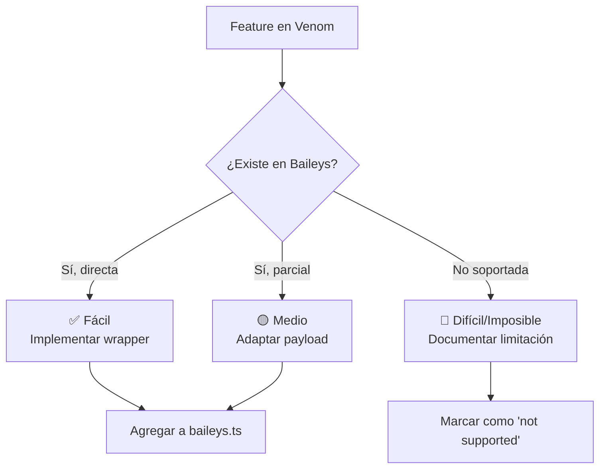

# 🔄 Comparativa `bot-wa-baileys` vs `venom-bot` y Plan de Migración

> Documento generado para comparar las funcionalidades de **tu proyecto** (`@bot-wa/bot-wa-baileys`, basado en `@whiskeysockets/baileys`) con **Venom v6** (`venom-bot`, basado en Puppeteer + CDP).
>
> **Objetivo:** detectaracionalmente features de Venom que no existen en tu bot y generar un **plan de trabajo priorizado** para incorporarlas — **manteniendo Baileys** como motor (no migrando a Puppeteer).

- **Fecha:** 2026-07-17
- **Tu stack:** TypeScript + Baileys 6.7.21 (WebSocket puro, sin navegador)
- **Venom stack:** TypeScript + Puppeteer 24 (Chrome headless, CDP)

---

## ⚠️ Diferencia Arquitectónica Fundamental

| Aspecto               | Tu bot (Baileys)                                          | Venom v6 (Puppeteer)                                      |
| --------------------- | --------------------------------------------------------- | --------------------------------------------------------- |
| **Motor**             | Reverse-engineering del protocolo Multi-Device (WebSocket)| Automatización de WhatsApp Web real con Chromium           |
| **Dependencia pesada**| Ninguna (solo Node)                                        | ~300 MB de Chromium descargado en `postinstall`           |
| **RAM/CPU**           | 🟢 Baja (sin navegador)                                   | 🔴 Alta (un Chrome por sesión)                            |
| **Multi-sesión**      | 🟢 Trivial (correr N instancias)                          | 🟡 Costoso (N procesos Chromium)                          |
| **Estabilidad**       | 🟡 Rompe cuando Meta cambia el protocolo                  | 🟢 Más resiliente (usa WA Web real), pero más pesado      |
| **Riesgo de ban**     | 🟢 Bajo (legítimo Multi-Device)                           | 🟡 Medio ( Headless detectable)                           |
| **Acceso a UI**       | 🔴 Limitado a la API del protocolo                        | 🟢 Cualquier cosa que WA Web pueda hacer                  |
| **Implementación funcional** | Llama funciones internas de Baileys                | Inyecta JS que llama a módulos internos de WA Web (`WWebJS`, `WAWeb*`) vía `page.evaluate` |

> **Conclusión estratégica:** **No migrar a Puppeteer.** Tu enfoque con Baileys es más liviano, portable y escalable. Lo que sí vale la pena es **replicar el catálogo de features** de Venom traducidas a la API equivalente de Baileys, donde exista.

---

## 🧩 Árbol de decisiones — ¿Qué traer de Venom?



---

## 📊 Matriz Comparativa de Features (Matriz Maestra)

### 🟦 1. Envío de mensajes

| Feature                              | Tu bot (Baileys) | Venom v6 | Método equivalente Baileys                                              | Prioridad |
| ------------------------------------ | :--------------: | :------: | ----------------------------------------------------------------------- | :-------: |
| Texto                                |        ✅        |    ✅    | `sock.sendMessage(jid, { text })`                                       |    —      |
| Texto con reply/quoted               |        ✅        |    ✅    | `sendMessage({ quoted: key })`                                          |    —      |
| Texto con menciones                  |        ⚠️        |    ✅    | `sendMessage({ mentions: [...], text, contextInfo })`                   | **Alta**  |
| Imagen desde URL/path                |        ✅        |    ✅    | ya existe `sendImage`                                                   |    —      |
| Imagen desde Base64                  |        ❌        |    ✅    | `sendMessage({ image: Buffer.from(b64, 'base64') })`                    | **Media** |
| Documento (PDF, DOCX…)               |        ✅        |    ✅    | ya existe `sendFile`                                                    |    —      |
| Documento desde Base64               |        ❌        |    ✅    | `sendMessage({ document: Buffer, fileName, mimetype })`                 | **Media** |
| Audio (PTT / voice)                  |        ✅        |    ✅    | ya existe `sendAudio`                                                   |    —      |
| Audio desde Base64                   |        ❌        |    ✅    | igual que sendAudio con Buffer                                          | **Media** |
| Video desde URL/path                 |        ✅        |    ✅    | ya existe `sendVideo`                                                   |    —      |
| Sticker estático                     |        ✅        |    ✅    | ya existe `sendSticker`                                                 |    —      |
| Sticker animado (GIF/WebP)           |        ✅        |    ✅    | `sendMessage({ sticker: { url }, animated: true })`                     |    —      |
| Ubicación                            |        ✅        |    ✅    | ya existe `sendLocation`                                                |    —      |
| Contacto (vCard único)               |        ✅        |    ✅    | ya existe `sendContact`                                                 |    —      |
| Lista de contactos (vCard list)      |        ❌        |    ✅    | `sendMessage({ contacts: { contacts: [...] } })`                        | **Media** |
| Encuesta                             |        ✅        |    ✅    | ya existe `sendPoll`                                                    |    —      |
| Link con preview automático          |        ❌        |    ✅    | `sendMessage({ text: url, linkPreview: ... })`                          | **Media** |
| Reacción (emoji)                     |        ✅        |    ❌    | TÚ tienes `sendReaction`, Venom NO                                      |    —      |
| Forward (reenviar mensajes)          |        ❌        |    ✅    | `sock.sendMessage(jid, { forward: msg })`                               | **Alta**  |
| Delete para todos                    |        ❌        |    ✅    | `sock.sendMessage(jid, { delete: key })`                                | **Alta**  |

### 🟩 2. Recepción y Eventos

| Feature                              | Tu bot           | Venom v6 | Status Baileys                                                           | Prioridad |
| ------------------------------------ | :--------------: | :------: | ------------------------------------------------------------------------ | :-------: |
| Mensaje entrante                     |        ✅        |    ✅    | ya tienes `message`                                                      |    —      |
| Cualquier mensaje (incl. enviado)    |        ❌        |    ✅    | Escuchar `messages.upsert` con `type: 'append'` además de `'notify'`     | **Media** |
| ACK (sent/received/read/played)      |        ❌        |    ✅    | `messages.update` → `update.status` + `message-status` event             | **Alta**  |
| Reacción entrante                    |        ✅        |    ❌    | ya tienes `reaction`                                                     |    —      |
| Cambio de estado de conexión         |        ✅        |    ✅    | ya tienes `connection.update`                                            |    —      |
| Llamada entrante (`incoming_call`)   |        ❌        |    ✅    | Baileys emite `call` event → rechazar/aceptar                            | **Alta**  |
| Live Location                        |        ❌        |    ✅    | `messages.upsert` con `message.liveLocationMessage`                      | **Baja**  |
| Participantes grupo (join/leave)     |        ❌        |    ✅    | `group-participants.update` event                                        | **Media** |
| Agregado a grupo                     |        ❌        |    ✅    | Igual, derivado de `group-participants.update`                           | **Baja**  |

### 🟨 3. Gestión de Grupos

| Feature                              | Tu bot           | Venom v6 | Status Baileys                                                           | Prioridad |
| ------------------------------------ | :--------------: | :------: | ------------------------------------------------------------------------ | :-------: |
| Listar miembros                      |        ❌        |    ✅    | `sock.groupParticipants(jid)`                                            | **Alta**  |
| Listar admins                        |        ❌        |    ✅    | Filtrar `groupMetadata` por `admin`                                      | **Alta**  |
| Crear grupo                          |        ❌        |    ✅    | `sock.groupCreate(name, participants)`                                   | **Media** |
| Añadir participante                  |        ❌        |    ✅    | `sock.groupParticipantsUpdate(jid, [id], 'add')`                         | **Media** |
| Eliminar participante                |        ❌        |    ✅    | `groupParticipantsUpdate(jid, [id], 'remove')`                           | **Media** |
| Promover a admin                     |        ❌        |    ✅    | `groupParticipantsUpdate(jid, [id], 'promote')`                          | **Media** |
| Degradar admin                       |        ❌        |    ✅    | `groupParticipantsUpdate(jid, [id], 'demote')`                           | **Media** |
| Salir de grupo                       |        ❌        |    ✅    | `sock.groupLeave(jid)`                                                   | **Media** |
| Cambiar descripción                  |        ❌        | ✅       | `sock.groupUpdateDescription(jid, desc)`                                 | **Media** |
| Cambiar nombre                       |        ❌        | ✅       | `sock.groupUpdateSubject(jid, name)`                                     | **Media** |
| Link de invitación                   |        ❌        | ✅       | `sock.groupInviteCode(jid)` → formatear URL                              | **Media** |
| Revocar link                         |        ❌        | ✅       | `sock.groupRevokeInvite(jid)`                                            | **Baja**  |
| Unirse por link                      |        ❌        | ✅       | `sock.groupAcceptInvite(code)`                                           | **Media** |
| Group metadata (titulo, desc…)       |        🟡        | ✅       | `sock.groupMetadata(jid)` — ya tienes `groupMetadata` en store           | **Alta**  |

### 🟧 4. Perfil y Dispositivo

| Feature                              | Tu bot           | Venom v6 | Status Baileys                                                           | Prioridad |
| ------------------------------------ | :--------------: | :------: | ------------------------------------------------------------------------ | :-------: |
| Cambiar foto de perfil               |        ❌        | ✅       | `sock.updateProfilePicture(jid, buffer)`                                 | **Media** |
| Cambiar nombre de perfil             |        ❌        | ✅       | `sock.updateProfileName(name)`                                           | **Media** |
| Cambiar "About/Status"               |        ❌        | ✅       | `sock.updateProfileStatus(text)`                                         | **Media** |
| Obtener foto de perfil              |        ❌        | ✅       | `sock.profilePictureUrl(jid)`                                            | **Alta**  |
| Verificar si número existe (boolean) |        ❌        | ✅       | `sock.onWhatsApp(jid)`                                                   | **Alta**  |
| Obtener versión de WA                |        🟡        | ✅       | ya tienes `fetchLatestBaileysVersion`                                    |    —      |
| Battery level                        |        ❌        | ✅       | ❌ **No existe en Multi-Device** (era legacy)                              | _N/A_     |
| Host device info                     |        ❌        | ✅       | `sock.user` + `sock.authState.creds.me`                                  | **Baja**  |

### 🟥 5. Chat Actions / Utilities

| Feature                              | Tu bot           | Venom v6 | Status Baileys                                                           | Prioridad |
| ------------------------------------ | :--------------: | :------: | ------------------------------------------------------------------------ | :-------: |
| Marcar como visto (send seen)        |        ❌        | ✅       | `sock.readMessages([key])`                                               | **Alta**  |
| Indicador "escribiendo…"             |        ✅        | ✅       | ya tienes `sendPresenceUpdate('composing')`                              |    —      |
| Indicador "grabando…"                |        ✅        | ✅       | ya tienes `sendPresenceUpdate('recording')`                              |    —      |
| Bloquear contacto                    |        ❌        | ✅       | `sock.updateBlockStatus(jid, 'block')`                                   | **Media** |
| Desbloquear contacto                 |        ❌        | ✅       | `sock.updateBlockStatus(jid, 'unblock')`                                 | **Media** |
| Lista de bloqueados                  |        ❌        | ✅       | `sock.getBlockedList?.()` (según versión)                                | **Baja**  |
| Silenciar chat (mute)                |        ❌        | ✅       | `sock.chatModify(jid, { mute: ms })`                                     | **Baja**  |
| Archivar/desarchivar                 |        ❌        | ✅       | `sock.chatModify(jid, { archive: bool })`                                | **Baja**  |
| Marcar chat fijo (pin)               |        ❌        | ✅       | ❌ No soportado por Baileys en API pública                                | _N/A_     |
| Eliminar chat                        |        ❌        | ✅       | `sock.chatModify(jid, { clear: true })`                                  | **Baja**  |
| Vaciar mensajes                      |        ❌        | ✅       | igual                                                                    | **Baja**  |
| Descargar media (decryptFile)        |        ❌        | ✅       | Ya importas `downloadMediaMessage` — **solo exponerla como método**      | **Alta**  |
| Logout                               |        🟡        | ✅       | borras sesión actual vía `clearSessionAndRestart`                        |    —      |
| Cerrar sesión limpio                 |        ✅        | ✅       | `sock.end(new Error('logout'))` + rm sessions                            | **Media** |

### 🟪 6. Datos / Histórico

| Feature                              | Tu bot           | Venom v6 | Status Baileys                                                           | Prioridad |
| ------------------------------------ | :--------------: | :------: | ------------------------------------------------------------------------ | :-------: |
| Listar todos los chats               |        🟡        | ✅       | `store.chats.all()` — ya tienes en store                                 | **Media** |
| Listar todos los contactos           |        ❌        | ✅       | `sock.fetchAllContacts?.()` o derivar de `contacts.upsert`               | **Media** |
| Historial de mensajes de un chat     |        ❌        | ✅       | `store.messages[jid]` limitado a lo recibido en runtime                   | **Baja**  |
| Multi-sesión (varias cuentas)        |        🟡        | ✅       | Posible corriendo N `BaileysClass` con `name` distinto — **documentar**  | **Media** |

### 🟫 7. DX (Developer Experience)

| Feature                              | Tu bot           | Venom v6 | Status                                                                   | Prioridad |
| ------------------------------------ | :--------------: | :------: | ------------------------------------------------------------------------ | :-------: |
| Tipado estricto (`strict: true`)     |        ❌        | ✅       | `tsconfig`: cambiar `strict: false` → `true`                             | **Media** |
| ESLint + Prettier                    |        ❌        | ✅       | Configurar `.eslintrc.cjs` + `.prettierrc`                               | **Baja**  |
| Tests automatizados                  |        ❌        | ✅       | Test folder con Vitest/Jest                                              | **Baja**  |
| Docs con TypeDoc                     |        ❌        | ✅       | `typedoc.json` en Venom — generar referencia de API                      | **Baja**  |
| CI/CD en GitHub Actions              |        ❌        | ✅       | Workflow `build.yml` + release-it                                        | **Baja**  |
| Logs estructurados (pino IP/JSON)    |        ✅        | ✅       | ya tienes pino                                                           |    —      |

---

## 🗺️ Plan de Trabajo Priorizado

> Orden por **valor/esfuerzo**. Cada item incluye archivo destino (dentro de `src/`) y snippet orientativo.

### 🚀 **Fase 1 — Quick Wins (1–2 días)**

Features de alto valor con poco esfuerzo porque Baileys las soporta nativamente.

#### 1.1 Download de media (`downloadFile`)
- **Problema:** Ya importas `downloadMediaMessage` pero no la expones.
- **Archivo:** `src/baileys.ts`
- **Tarea:** Agregar método público `downloadMedia(message)` que devuelva Buffer.
- **Uso del usuario:** poder guardar imagen/audio/video recibido en disco.

#### 1.2 Send visto / marcar como leído
- **Método:** `sendSeen = async (jid) => this.sock.readMessages([{ remoteJid: jid, id: msgId }])`
- **Archivo:** `src/baileys.ts`.

#### 1.3 Forward (reenviar) mensajes
- **Método:** `forwardMessage = async (to, msg) => this.sock.sendMessage(to, { forward: msg })`.

#### 1.4 Delete para todos
- **Método:** `deleteMessage = async (jid, key) => this.sock.sendMessage(jid, { delete: key })`.

#### 1.5 Verificar si número existe
- **Método:** `checkNumberStatus = async (jid) => this.sock.onWhatsApp(jid)`.

#### 1.6 Foto de perfil
- **Método:** `getProfilePic = async (jid) => this.sock.profilePictureUrl(jid)`.

#### 1.7 Evento `ack` (estado del mensaje)
- **Problema:** Actualmente ignoras `messages.update` no-poll. Exponerlo.
- **En `busEvents`:** agregar handler para `message-status-update` o extender `messages.update` para emitir `ack` con estatus `{ pending, sent, delivered, read }`.

#### 1.8 Evento `incoming_call`
- **Tarea:** En `busEvents` agregar listener de `call` event de Baileys. Emitir `incoming_call`.

---

### 🔨 **Fase 2 — Grupos & Perfil (3–5 días)**

#### 2.1 Suite de gestión de grupos
Métodos a agregar en `src/baileys.ts`:

```ts
getGroupMembers(jid)              → this.sock.groupMetadata(jid).participants
getGroupAdmins(jid)               → ...filter(p => p.admin)
createGroup(name, participants)   → this.sock.groupCreate(...)
addParticipant(gid, pid)          → this.sock.groupParticipantsUpdate(gid, [pid], 'add')
removeParticipant(gid, pid)       → ... , 'remove')
promoteParticipant(gid, pid)      → ... , 'promote')
demoteParticipant(gid, pid)       → ... , 'demote')
leaveGroup(gid)                   → this.sock.groupLeave(gid)
setGroupDescription(gid, d)       → this.sock.groupUpdateDescription(gid, d)
setGroupName(gid, n)              → this.sock.groupUpdateSubject(gid, n)
getGroupInviteLink(gid)           → this.sock.groupInviteCode(gid)
revokeGroupInviteLink(gid)        → this.sock.groupRevokeInvite(gid)
joinGroup(code)                   → this.sock.groupAcceptInvite(code)
```

#### 2.2 Evento participantes de grupo
- Listener `group-participants.update` → emit `group_participants_changed` con `{ action: 'add'|'remove'|'promote'|'demote', jid, participants }`.

#### 2.3 API de perfil
```ts
setProfilePic(buffer)
setProfileName(name)
setProfileStatus(text)
```
- Usar `this.sock.updateProfilePicture`, `updateProfileName`, `updateProfileStatus`.

#### 2.4 Bloqueo/desbloqueo
```ts
blockContact(jid)   → this.sock.updateBlockStatus(jid, 'block')
unblockContact(jid) → this.sock.updateBlockStatus(jid, 'unblock')
```

---

### 🎨 **Fase 3 — Media Base64 & Extras (5–7 días)**

#### 3.1 Send desde Base64
```ts
sendImageFromBase64(jid, b64, caption?)
sendFileFromBase64(jid, b64, filename, mimetype, caption?)
sendVoiceFromBase64(jid, b64)
```
Implementación común: `Buffer.from(b64, 'base64')` → `sendMessage({ image: buffer, caption })`.

#### 3.2 Send vCard list
```ts
sendContactList(jid, contacts[])
→ this.sock.sendMessage(jid, { contacts: { displayName, contacts: [{ vcard }] } })
```

#### 3.3 Link preview explícito
- `sendLinkPreview(jid, url, text)` usando `sendMessage({ text, linkPreview })`. Baileys lo hace por default con URLs pero bueno exponerlo.

#### 3.4 Cualquier mensaje (`onAnyMessage`)
- En `busEvents`, escuchar también `messages.upsert` con `type === 'append'` para atrapar mensajes propios (echo). Emitir evento `message_create` (alias de Venom) además de `message`.

---

### ⚙️ **Fase 4 — DX & Calidad (continua)**

#### 4.1 Activar `strict: true` en `tsconfig.json`
```json
"strict": true,
"strictNullChecks": true,
"noImplicitAny": true,
"strictPropertyInitialization": true  // requerirá changes en BaileysClass
```

#### 4.2 ESLint + Prettier
- Copiar `.eslintrc.cjs` y `.prettierrc` de Venom como base.

#### 4.3 TypeDoc
- Crear `typedoc.json` para generar `docs/` automáticamente.

#### 4.4 Tests con Vitest
- Crear carpeta `test/` con mocks de socket.

#### 4.5 CI GitHub Actions
- Workflow que corra `pnpm build` + lint en cada push.

#### 4.6 Documentación
- Actualizar `README.md` con tabla de métodos (como Venom), addLink a `PROJECT.md` y a este `MIGRATION_VENOM.md`.

---

## 📈 Prioridad Resumida (Top 15 quick-wins)

| # | Feature                  | Esfuerzo | Valor | Método Baileys                          |
| - | ------------------------ | :------: | :---: | --------------------------------------- |
| 1 | `downloadMedia`          |   XS     | ⭐⭐⭐  | ya tienes `downloadMediaMessage` import |
| 2 | `sendSeen`               |   XS     | ⭐⭐⭐  | `sock.readMessages`                     |
| 3 | `deleteMessage`          |   XS     | ⭐⭐⭐  | `sendMessage({ delete })`               |
| 4 | `forwardMessage`         |   XS     | ⭐⭐   | `sendMessage({ forward })`              |
| 5 | `checkNumberStatus`      |   XS     | ⭐⭐⭐  | `sock.onWhatsApp`                       |
| 6 | `getProfilePic`          |   XS     | ⭐⭐   | `sock.profilePictureUrl`                |
| 7 | Evento `ack`              |   S      | ⭐⭐⭐  | extender `messages.update`              |
| 8 | Evento `incoming_call`   |   S      | ⭐⭐⭐  | `sock.ev.on('call')`                    |
| 9 | `getGroupMembers/Admins` |   S      | ⭐⭐⭐  | `sock.groupMetadata`                    |
| 10| `addParticipant` y variants |   S   | ⭐⭐   | `groupParticipantsUpdate`               |
| 11| `blockContact`           |   XS     | ⭐⭐   | `updateBlockStatus`                     |
| 12| `setProfilePic/Name/Status` | S     | ⭐⭐   | `updateProfile*`                        |
| 13| `sendImageFromBase64`    |   XS     | ⭐⭐   | `Buffer.from(b64)`                      |
| 14| `sendContactList` (vCard list) | S  | ⭐⭐   | `sendMessage({ contacts })`             |
| 15| Evento `group_participants` | S      | ⭐⭐   | `group-participants.update`             |

---

## ❌ Features de Venom que **NO** se pueden replicar en Baileys

| Feature              | Motivo                                                                     |
| -------------------- | -------------------------------------------------------------------------- |
| Battery level        | Eliminado del protocolo Multi-Device (solo existía en legacy)              |
| Pin chat             | Baileys no expone API pública para fijar chats                             |
| Custom WA Web version| N/A (Baileys no usa WA Web)                                                |
| Modo headless toggle | N/A                                                                        |

---

## ✅ Features que **TÚ tienes y Venom NO**

- **`sendReaction`** — Venom no expone reacciones en su client
- **`sendTextWithQuote`** — Venom solo tiene `reply()` genérico
- **Sistema de Flows (`addKeyword().addAnswer().addAction()`)** — Venom no tiene un DSL de flujos, tú sí (`src/flows.ts`)
- **Modo plugin (`createProvider`)** — veneno no está diseñado como provider pluggable
- **Store concurrente con write locks y backup** (`src/store.ts`) — Venom usa localStorage del browser

Estas son **ventajas competitivas** a preservar y destacar.

---

## 📌 Recomendación Estratégica Final

1. **No migrar a Puppeteer.** Baileys te da 90% de las features con 10% del coste operacional.
2. **Implementar Fases 1 y 2 primero** — gap más grande con Venom y más solicitadas por usuarios.
3. **Cubrir lo más visible primero:** grupos (gestión) + download media + forward/delete. Estas son las "features faltantes" más perceptibles al comparar APIs.
4. **Preservar tus ventajas:** Flows, sendReaction, sendTextWithQuote, modo plugin — uniq en tu implementación.
5. **Mantener el mismo naming pattern** que Venom cuando sea razonable (`sendImageFromBase64`, `checkNumberStatus`, `groupMembers`…) para reducir fricción a quienes migren desde Venom.

---

*Documento generado por análisis estático de ambos repositorios. Última actualización: 2026-07-17.*
