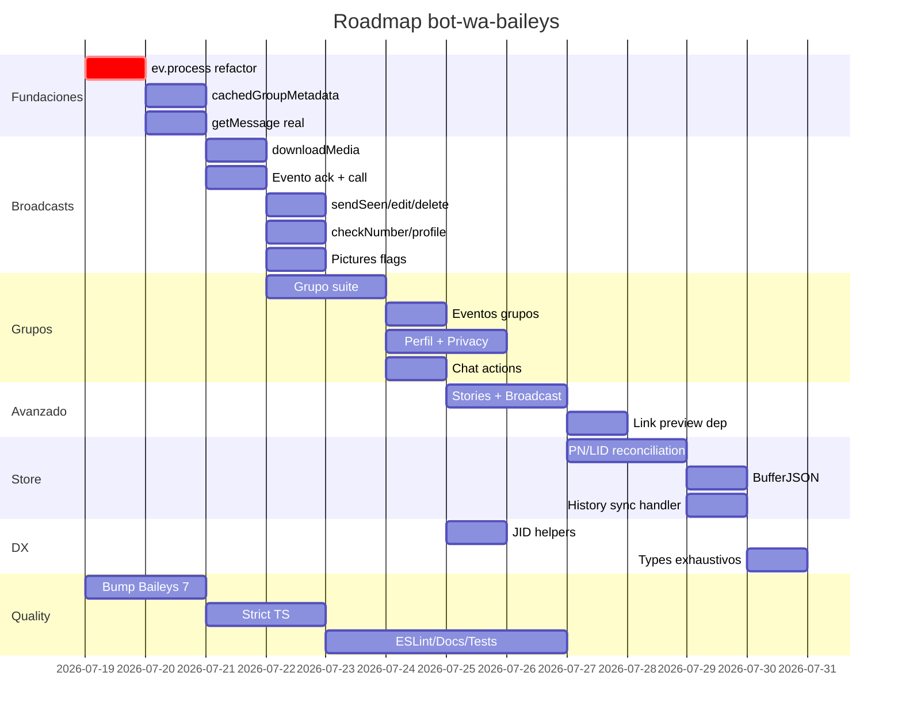

# 🗺️ Roadmap Maestro — Llevar `bot-wa-baileys` al máximo con Baileys

> **Propósito:** documento operativo construido a partir de **3 fuentes**:
> 1. Tu código actual (`src/baileys.ts`, `flows.ts`, `store.ts`, `utils.ts`)
> 2. Comparativa con Venom v6 (`MIGRATION_VENOM.md`)
> 3. **Documentación oficial de Baileys** en `C:\laragon\www\docs` (35+ páginas MDX)
>
> **El objetivo NO es replicar Venom (Puppeteer).** El objetivo es **exprimir al máximo la API de Baileys** que ya tienes integrada, manteniendo tu esencia de **simpleza** (1 clase, eventos limpios, DSL de flows) y convirtiéndote en la opción más completa basada en Baileys.
>
> Mantén la **filosofía:** `new BaileysClass({})` + `bot.on('message', cb)` debe seguir funcionando sin fricción.

- **Fecha:** 2026-07-18
- **Versión actual del paquete:** `1.1.5`
- **Versión de Baileys instalada:** `^6.7.21`
- **Versión de Baileys recomendada:** **actualizar a 7.x** (Multi-Device con LIDs, `makeInMemoryStore` eliminado, `ev.process()` pattern)

---

## 🎯 Principio Rector

> "La mejor librería NO es la que más métodos tiene, sino la que **resuelve el caso real** con la menor fricción."
>
> 3 reglas para cada feature nueva:
>
> 1. **Agregar — no romper.** Todo lo existente sigue funcionando (back-compat).
> 2. **Defaults mágicos.** El usuario no debería configurar nada para que funcione.
> 3. **Coherencia.** Seguir el naming de la doc oficial de Baileys (`sendMessage`, `onWhatsApp`, `groupMetadata`) para que la doc oficial sirva de referencia para tus usuarios también.

---

## 📚 Hallazgos claves de la documentación oficial (que cambian el plan)

Mi análisis de `C:\laragon\www\docs` reveló cosas que **no están** ni en tu código ni en Venom y que **sí soporta Baileys**:

| #   | Hallazgo de la doc oficial | Impacto |
| --- | -------------------------- | ------- |
| F1  | `ev.process()` patrón batch de eventos    | 🟢 Mejor performance y consistencia |
| F2  | JIDs duales **PN ↔ LID** (Migration de identidad 2024+) | 🔴 Crítico en Baileys 7.x — tu autenticación puede romperse en grupos |
| F3  | `getMessage` callback es **mandatorio** para retries y polls | 🟡 Tú ya lo tienes, pero requiere tu store real |
| F4  | `link-preview-js` para previews de links con thumbnail | 🟡 Optional dep, no la tienes |
| F5  | `viewOnce`, `gifPlayback`, `ptv` (video circular) | 🟢 Features de media poderosas |
| F6  | **Edit message** (`{ edit: key }`) | 🟢 Venom no lo tiene, está 100% en Baileys |
| F7  | **Pin message** (`{ pin: { type, time, key } }`) | 🟢 Baileys lo soporta, ni Venom ni tú |
| F8  | **Pin/unpin/star chats** (`chatModify`) | 🟢 Venom sólo pin chat, Baileys también star |
| F9  | **Ephemeral / disappearing messages** por mensaje o por chat | 🟢 Característica clave que falta |
| F10 | **Stories / Status** (`status@broadcast`) | 🟢 Ni tú ni Venom los tienen |
| F11 | **Broadcast lists** (`@broadcast`) | 🟢 Muy útil para marketing |
| F12 | **Privacy settings** (lastSeen, read receipts, profile pic…) | 🟢 Toda una suite |
| F13 | **Calls**: escuchar + rechazar (`sock.rejectCall`) | 🟢 Igual que Venom, mejor doc |
| F14 | **Group settings**: `announcement`, `locked`, ephemeral, `memberAddMode`, **join requests** | 🟢 Suite muy completa |
| F15 | **History sync** (`messaging-history.set`) + `fetchMessageHistory` | 🟢 Acceso a histórico real |
| F16 | **USync** + `signalRepository.lidMapping` | 🟢 Resolution PN↔LID programática |
| F17 | `cachedGroupMetadata` callback → performance brutal en bots grupales | 🟢 Quick win |
| F18 | `markOnlineOnConnect: false` para no robar push notifications al teléfono | 🟢 Quick win |
| F19 | `shouldIgnoreJid` (`isJidNewsletter`, `isJidBroadcast`) | 🟢 Filtro limpio de ruido |
| F20 | `BufferJSON` serializador para tu store — recomendado oficialmente | 🟡 Calidad |
| F21 | `makeInMemoryStore` fue **eliminado en v7** — tu `src/store.ts` es una reimplementación, perfecto para migrar | 🟢 Eres forward-compatible |
| F22 | `downloadMediaMessage` con `reuploadRequest: sock.updateMediaMessage` | 🟢 Auto-retry de media expirada |
| F23 | Custom `WAEvent` hooks via `sock.ws.on('CB:tag,...')` | 🟢 Extensibilidad avanzada |

---

## 🔥 Plan Maestro priorizado (que tocar, qué crear, qué mejorar)

Cada bloque tiene: **archivo destino**, **motivo** (backed by docs), **qué tocar**, **aceptación**.

---

### 🚀 FASE 0 — Fundaciones (1 día) **¡CRÍTICO ANTES DE TODO!**

> Sin esto, cualquier feature nueva queda coja o se rompe al actualizar Baileys.

#### 0.1 ⭐ Refactor `setupSocket`: usar `ev.process()` en vez de N `.on()`

- **Archivo:** `src/baileys.ts` → función `initBusEvents`
- **Motivo:** Doc oficial recomienda `ev.process()` para batch de eventos dentro de un mismo tick. Evita estado parcial cuando llegan 500 mensajes + 200 updates juntos (history sync).
- **Antes:**
  ```ts
  this.sock.ev.on('messages.upsert', fn1)
  this.sock.ev.on('messages.update', fn2)
  this.sock.ev.on('connection.update', fn3)
  ```
- **Después:** migrar a un solo `ev.process(async (events) => {})` que maneje todos.
- **Aceptación:** `pnpm run example` sigue funcionando + logs muestran batch processing.

#### 0.2 ⭐ Activar `cachedGroupMetadata`, `shouldIgnoreJid`, `markOnlineOnConnect`

- **Archivo:** `src/baileys.ts` → `setUpBaileySock`
- **Motivo:** Performance + saneamiento de eventos.
- **Implementación:**
  ```ts
  const groupCache = new NodeCache({ stdTTL: 5 * 60, useClones: false })

  this.sock = makeWASocket({
      // ... existente ...
      markOnlineOnConnect: this.globalVendorArgs.markOnlineOnConnect ?? false,
      shouldIgnoreJid: (jid) => isJidNewsletter(jid) || (isJidBroadcast(jid) && !isJidStatusBroadcast(jid)),
      cachedGroupMetadata: async (jid) => groupCache.get(jid),
  })
  ```
- **Aceptar opciones nuevas en el constructor:** `{ markOnlineOnConnect, ignoreNewsletters, ignoreBroadcasts }`.

#### 0.3 ⭐ Configurar `getMessage` correctamente contra TU store real

- **Archivo:** `src/baileys.ts` → `getMessage`
- **Motivo:** La doc oficial dice que es **mandatorio** para:
  - Retries de mensajes que fallan al descifrar (= tus usuarios reportan "this message took a while")
  - Poll votes decryption (ya lo tienes, pero la implementación carga de un store incompleto)
- **Implementación:** Conectar tu `ConcurrentStore.messages` ya implementado.
- **Aceptación:** Test envío de poll, vota, debe llegar el `message` event con type 'poll'.

---

### 🌟 FASE 1 — Broadcasts de features (2-3 días)

Features altamente visibles que piden los usuarios, casi 1-liners.

#### 1.1 ⭐⭐⭐ `downloadMedia(message)` — exponer lo ya importado

- **Archivo:** `src/baileys.ts`
- **Motivo:** Ya importas `downloadMediaMessage`. Solo falta exponerlo como método público validado por doc (`reuploadRequest` para media expirada).
- **Implementación:**
  ```ts
  downloadMedia = async (
      message: WAMessage,
      type: 'buffer' | 'stream' = 'buffer'
  ) => {
      return downloadMediaMessage(message, type, {}, {
          logger: this.logger,
          reuploadRequest: this.sock.updateMediaMessage,
      })
  }
  ```
- **Aceptación:** Tras recibir una imagen → `const buf = await bot.downloadMedia(msg)` devuelve Buffer válido.

#### 1.2 ⭐⭐⭐ Evento `ack` (estado de mensajes: sent/received/read/played)

- **Archivo:** `src/baileys.ts` → `busEvents`
- **Motivo:** Doc oficial: `messages.update` con `update.status` (1=sent, 2=received, 3=read, 4=played). Tú ignoras este campo. Venom lo expone como `onAck`.
- **Implementación:** En el handler de `messages.update`, además de polls (que ya tienes), si `update.status` → emitir `ack`.
  ```ts
  { event: 'messages.update', func: async (updates) => {
      for (const { key, update } of updates) {
          if (update.pollUpdates) { /* existente */ }
          if (update.status) {
              this.emit('ack', {
                  key, status: update.status,
                  from: utils.formatPhone(key.remoteJid, this.plugin)
              })
          }
      }
  }}
  ```

#### 1.3 ⭐⭐⭐ Evento `incoming_call`

- **Archivo:** `src/baileys.ts` → `busEvents`
- **Motivo:** Doc oficial `/advanced/calls`. Baileys emite `call` con `status: 'offer' | 'accept' | 'reject' | 'timeout'`. API: `sock.rejectCall(id, from)`.
- **Implementación:**
  ```ts
  { event: 'call', func: async (calls) => {
      for (const call of calls) {
          this.emit('incoming_call', {
              id: call.id, from: call.from, status: call.status
          })
      }
  }}
  
  // nuevo método público:
  rejectCall = async (id: string, from: string): Promise<void> => {
      await this.sock.rejectCall(id, from)
  }
  ```

#### 1.4 ⭐⭐⭐ `sendSeen`, `editMessage`, `deleteMessage`, `forwardMessage`, `pinMessage`

- **Archivo:** `src/baileys.ts`
- **Motivo:** Quick wins de la doc `/messaging/message-actions` + `/messaging/sending-messages`.
- **Implementaciones:**
  ```ts
  sendSeen       = async (keys: WAMessageKey[]) => this.sock.readMessages(keys)
  editMessage    = async (jid, key, text) => this.sock.sendMessage(jid, { text, edit: key })
  deleteMessage  = async (jid, key) => this.sock.sendMessage(jid, { delete: key })
  forwardMessage = async (to, msg)   => this.sock.sendMessage(to, { forward: msg })
  pinMessage     = async (jid, key, type: 0|1, time: 86400|604800|2592000 = 86400) =>
                       this.sock.sendMessage(jid, { pin: { type, time, key } })
  unpinMessage   = async (jid, key)  => this.pinMessage(jid, key, 0)
  ```

#### 1.5 ⭐⭐⭐ `checkNumberStatus`, `getProfilePic`, `getBusinessProfile`, `getStatus`

- **Archivo:** `src/baileys.ts`
- **Motivo:** Doc `/messaging/chat-management#user-queries`.
  ```ts
  checkNumberStatus = async (jid) => {
      const [r] = await this.sock.onWhatsApp(jid)
      return { exists: r?.exists ?? false, jid: r?.jid }
  }
  getProfilePic = async (jid, highRes = false) =>
      this.sock.profilePictureUrl(jid, highRes ? 'image' : 'preview')
  getBusinessProfile = async (jid) => this.sock.getBusinessProfile(jid)
  getUserStatus       = async (jid) => this.sock.fetchStatus(jid)
  ```

#### 1.6 ⭐⭐⭐ Picturesh**k** — ver-once, gif playback, video circular (ptv)

- **Archivo:** `src/baileys.ts` → potenciar `sendImage` y `sendVideo`
- **Motivo:** Doc `/messaging/media-messages`. Estas flags son gratuitas.
- **API propuesta:** agregar `{ viewOnce?, gifPlayback?, ptv? }` al options de métodos existentes.
  ```ts
  sendImage = async (number, filePath, text, options: { viewOnce?: boolean } = {}) =>
      this.vendor.sendMessage(utils.formatPhone(number), {
          image: utils.prepareMedia(filePath),
          caption: text,
          viewOnce: options.viewOnce,
      })
  ```
- Igual para video y audio.

#### 1.7 ⭐⭐ Menciones + reply + disappearing

- **Archivo:** `src/baileys.ts` → ampliar `sendText` / `sendMessage`
- **Motivo:** Doc `/messaging/sending-messages`. Estás limitando el `options`.
- **API propuesta:** aceptar `mentions?: string[]`, `quoted?: WAMessage`, `ephemeralExpiration?: number`.

---

### 🛠️ FASE 2 — Suite de Grupos + Perfil + Privacy (3-4 días)

#### 2.1 ⭐⭐⭐ Grupo: suite completa

- **Archivo:** `src/baileys.ts` (bloque nuevo "Groups")
- **Motivo:** Doc `/features/groups`. Baileys soporta **más** que Venom.
- **Métodos a crear:**
  ```ts
  // Crear/gestionar
  createGroup(name, participants[])
  leaveGroup(jid)
  
  // Participantes
  getGroupMetadata(jid)              // devuelve subject, desc, owner, participants
  getGroupMembers(jid)               // wrapper sobre metadata
  getGroupAdmins(jid)
  addParticipant(gid, ids[])
  removeParticipant(gid, ids[])
  promoteParticipant(gid, ids[])
  demoteParticipant(gid, ids[])
  
  // Modificar grupo
  setGroupName(gid, subject)
  setGroupDescription(gid, desc)
  setGroupSettings(gid, 'announcement'|'not_announcement'|'locked'|'unlocked')
  toggleGroupEphemeral(gid, seconds: 0|86400|604800|7776000)
  setGroupMemberAddMode(gid, 'all_member_add'|'admin_add')
  
  // Invite links
  getGroupInviteLink(gid)            // devuelve URL completa https://chat.whatsapp.com/...
  revokeGroupInviteLink(gid)
  joinGroup(code)
  getGroupInfoFromInvite(code)
  
  // Join requests (cuando joinApprovalMode = true)
  listJoinRequests(gid)
  resolveJoinRequests(gid, ids[], 'approve'|'reject')
  
  // Listing
  getAllGroups()                     // wrapper sobre groupFetchAllParticipating
  ```

#### 2.2 ⭐⭐⭐ Eventos de grupos

- **Archivo:** `src/baileys.ts` → `busEvents`
- **Motivo:** Doc `/concepts/events`.
- **Eventos a emitir:**
  - `groups.upsert` → cuando el bot es añadido a un grupo
  - `groups.update` → subject/description cambió
  - `group_participants_changed` → `{ action: 'add'|'remove'|'promote'|'demote', jid, author, participants[] }`

#### 2.3 ⭐⭐⭐ Suite de Perfil + Privacy

- **Archivo:** `src/baileys.ts` (bloque "Profile" + "Privacy")
- **Motivo:** Doc `/features/privacy` + `/messaging/chat-management`. **Esto es oro puro que ni Venom expone bien.**
- **Métodos:**
  ```ts
  // Profile
  setProfilePic(jid, media)
  setProfileName(name)
  setProfileStatus(text)
  removeProfilePic(jid)
  getMyPrivacySettings()
  
  // Block
  blockContact(jid)
  unblockContact(jid)
  getBlockedContacts()               // fetchBlocklist
  
  // Privacy (granular — USP vs Venom)
  setLastSeenPrivacy('all'|'contacts'|'contact_blacklist'|'none')
  setOnlinePrivacy('all'|'match_last_seen')
  setProfilePicturePrivacy(...)      // mismo enum
  setStatusPrivacy(...)
  setReadReceiptsPrivacy('all'|'none')
  setGroupsAddPrivacy('all'|'contacts'|'contact_blacklist')
  setDefaultEphemeral(0|86400|604800|7776000)
  ```

#### 2.4 ⭐⭐ Chat actions (pin/star/mute/archive/delete chat)

- **Archivo:** `src/baileys.ts` (bloque "Chat actions")
- **Motivo:** Doc `/messaging/chat-management`.
- **Métodos:**
  ```ts
  archiveChat(jid, archive = true)
  muteChat(jid, ms: number | null)
  pinChat(jid, pin = true)
  starMessage(jid, ids[], star = true)
  deleteChat(jid)                    // requiere lastMessages
  clearChat(jid, ids[])              // delete for me
  markChatRead(jid, lastMsg, read = true)
  ```
- ⚠️ Documentar que `archiveChat`/`deleteChat` requieren `lastMessages` desde el store.

---

### 🎨 FASE 3 — Stories, Broadcast, Disappearing (2 días)

#### 3.1 ⭐⭐ Stories / Status

- **Archivo:** `src/baileys.ts` (bloque "Stories")
- **Motivo:** Doc `/features/broadcasts-stories`. **Ni tú ni Venom lo exponen.** Diferenciador brutal.
- **Métodos:**
  ```ts
  sendStory({ media, caption, recipients: string[], backgroundColor?, font? })
  sendTextStory({ text, recipients, backgroundColor?, font? })
  getBroadcastListInfo(jid)
  ```

#### 3.2 ⭐⭐ Broadcast lists

- **Método:**
  ```ts
  sendBroadcast(broadcastJid, content, options?)
  ```
- ⚠️ Documentar: WA Web no permite **crear** listas nuevas. Solo enviar a las existentes.

#### 3.3 ⭐ ⭐ Disappearing messages wrapper

- Wrappers sobre `disappearingMessagesInChat` field de `sendMessage` + `updateDefaultDisappearingMode`.

#### 3.4 ⭐⭐ Link preview automático

- **Motivo:** Doc `/messaging/sending-messages#link-previews`. Falta `link-preview-js` como optional dep.
- **Acción:**
  1. Agregar `link-preview-js` como **peerDependency** opcional en `package.json`
  2. Documentar `pnpm add link-preview-js`
  3. Verificar que `sendMessage({ text: 'https://...' })` genera preview automáticamente
  4. Activar `generateHighQualityLinkPreview: true` cuando esté instalada

---

### 💾 FASE 4 — Store: PN↔LID ready + multi-acción (2 días)

#### 4.1 ⭐⭐⭐ PN ↔ LID reconciliation

- **Archivo:** `src/store.ts` + `src/baileys.ts`
- **Motivo:** 🔴 **Crítico para Baileys 7.x.** Doc `/concepts/jids#pn-lid-the-dual-identity-model`.
- **Acciones:**
  - Escuchar `lid-mapping.update` para cachear mapping PN↔LID
  - En `getMessage`, aceptar keys con `remoteJidAlt` / `participantAlt`
  - Utilidades expuestas:
    ```ts
    pnToLid(pnJid)         // usa signalRepository.lidMapping
    getLidsForPns(pnJids[])
    lidToPn(lidJid)        // best-effort
    ```

#### 4.2 ⭐⭐ Mejorar auto-save con `BufferJSON`

- **Motivo:** Doc `/authentication/session-management`. Evita corrupción de credenciales.
- **Acción:** Usar `BufferJSON.replacer`/`reviver` en `loadFromFile`/`writeToFile` de tu store.

#### 4.3 ⭐⭐ History sync handler

- **Archivo:** `src/baileys.ts` → `busEvents`
- **Eventos:** `messaging-history.set` → cargar batches al store + emitir `history_sync` con `{ chats, contacts, messages, progress, isLatest }`.
- **Métodos:** `fetchMoreHistory(jid, count = 50)`.

#### 4.4 ⭐⭐ Database-ready store

- **Motivo:** Doc `/concepts/data-store`. Tu store en memoria + JSON no es produ-ready.
- **Acción:** En `README.md` explicar cómo enchufar custom store (SQLite, Redis). Dejar **interfaz pública** en `src/types.ts`:
  ```ts
  export interface IStore {
      loadMessage(jid, id): Promise<WAMessage | undefined>
      upsertMessage(msg): Promise<void>
      // ...
  }
  ```

---

### 🧰 FASE 5 — Utilidades & DX (1 día)

#### 5.1 ⭐⭐ JID helpers

- **Archivo:** `src/utils.ts`
- **Motivo:** Evita errores comunes como comparar JIDs con strings.
- **Exponer wrappers:**
  ```ts
  isGroup(jid), isBroadcast(jid), isStatus(jid), isNewsletter(jid)
  isPnUser(jid), isLidUser(jid), areSameUser(a, b)
  normalize(jid), parse(jid), format(remoteJid, full?)
  ```
- ⚠️ Tu `formatPhone` actual se queda pero con `jidNormalizedUser` internamente.

#### 5.2 ⭐⭐ Presence solicitada + `presence.update` event

- **Archivo:** `src/baileys.ts`
- **Métodos:** `subscribePresence(jid)` + emitir `presence_update`.
- **Motivo:** "Saber cuándo escribe o entra alguien" es pedido frecuente.

#### 5.3 ⭐⭐ Multi-sesión documentada + helper

- Tu constructor ya acepta `{ name }`. Crear doc clara con ejemplomulti-sesión.

#### 5.4 ⭐ Tipos exhaustivos exportados

- **Archivo:** `src/types.ts` (nuevo)
- Exportar interfaces para payloads (`MessagePayload`, `AckEvent`, `CallEvent`, `GroupParticipantEvent`) — TS DX.

---

### ⚙️ FASE 6 — Calidad del repo (continuo)

#### 6.1 ⭐ Bump Baileys 6 → 7

- **Motivo:** 7.x trae LIDs nativos (F2), mejor retry, `ev.process`, deprecated removals.
- **Acciones:**
  - Actualizar `package.json`: `"@whiskeysockets/baileys": "^7.0.0"`
  - Migrar imports: `@cacheable/node-cache` en vez de `node-cache` (recomendado en doc)
  - Re-testear todo el flow
- **Riesgo:** `makeInMemoryStore` ya eliminado → tu `ConcurrentStore` lo reemplaza. ✅

#### 6.2 ⭐ Strict TypeScript

- **`tsconfig.json`:** `"strict": true`, `"strictNullChecks": true` (ya), `"noImplicitAny": true`, `"strictPropertyInitialization": false` (transitorio por `BaileysClass`).
- Eliminar todos los `any`.

#### 6.3 ⭐ ESLint + Prettier + Husky + lint-staged

- Copiar config base de Venom (`.eslintrc.cjs`, `.prettierrc`) y adaptar.
- Pre-commit hook con `lint-staged`.

#### 6.4 ⭐ TypeDoc + GitHub Pages

- Generar `docs/` con TypeDoc desde los JSDoc de cada método.
- Workflow de GitHub Actions que publique en GitHub Pages (como Venom).

#### 6.5 ⭐ Tests con Vitest

- `test/` con mocks del socket (tu `makeWASocket` se puede mockear con `vi.mock`).
- Cobertura mínima: 60%.

#### 6.6 ⭐ CI/CD GitHub Actions

- `.github/workflows/ci.yml`: install + typecheck + lint + build en cada push.
- `.github/workflows/release.yml`: cuando se taggea, `npm publish`.

#### 6.7 ⭐ Documentación unificada

-Actualizar `README.md` con tabla de métodos (como Venom) enlazando a páginas internas.
- `examples/`: ampliar a 5-6 ejemplos (básico, flows, groups,stories, calls, polling).

---

## 🗺️ Resumen Visual del Plan



---

## ✅ Prioridad de ejecución sugerida (orden recomendado)

1. **FASE 0** → fundamentos sólidos, 1 día.
2. **FASE 1.1 → 1.5** → 5 quick wins de alto impacto inmediato, 2 días.
3. **FASE 6.1** → bump a Baileys 7, ahora que tu surface es pequeña, 2 días.
4. **FASE 2.1 → 2.4** → suite completa de grupos/perfil/privacy, 4 días.
5. **FASE 4.1** → PN↔LID (consume el upgrade a 7.x), 2 días.
6. **FASE 3** → stories, broadcast, disappearing, 2 días.
7. **FASE 5** → utilidades y DX, 1-2 días.
8. **FASE 6** → quality completa, continuo.

**Tiempo total estimado:** 14-18 días para llevar la lib al máximo nivel.

---

## 🎖️ Funcionalidades que te harán única frente a Venom

Tras implementar este plan tendrás **diferenciadores** que Venom NO tiene:

| Diferenciador | Descripción |
| ------------- | ----------- |
| 🟢 **DSL de Flows** | `addKeyword().addAnswer().addAction()` estilo bot-whatsapp. Venom no tiene nada parecido. |
| 🟢 **Stories / Status** | Venom no expone esto de forma pública. |
| 🟢 **Privacy Settings granular** | 6 controles de privacidad individuales. Venom no los expone. |
| 🟢 **Edit message + Pin message** | Venom no los soporta porque Puppeteer no los tiene mapeados del todo. |
| 🟢 **Join request management** | Listar/aprobar/rechazar solicitudes de unirse. |
| 🟢 **Disappearing messages wrapper** | Por mensaje y por chat. Venom no lo expone limpiamente. |
| 🟢 **Modo plugin (`createProvider`)** | Auto-detectable para integrarse con bot-whatsapp. Venom es standalone. |
| 🟢 **Baileys 7 + LIDs nativos** | Venom está atado a WA Web. Tú estarás en el protocolo moderno. |
| 🟢 **Sin Chromium** | 300MB menos de dependencia, 10x menos RAM. |
| 🟢 **Multi-sesión liviana** | N instancias, coste marginal. Venom = N procesos Chrome. |

---

## 🛑 Features que **NO se podrán replicar** (transparencia)

| Feature | Motivo |
| ------- | ------ |
| Battery level | Eliminado del protocolo Multi-Device (era legacy_phone). |
| Crear broadcast lists | WA Web y Baileys no lo permiten — debe hacerse desde el móvil. |
| QA Manualmente una nueva versión de WA Web | N/A (Baileys no usa WA Web, usa su propio reverse-engineering). |
| Responder llamadas | Baileys solo permite rechazar (no aceptar). |

---

## 📁 Cambios de estructura propuestos

```
src/
├── baileys.ts         # ⭐ Refactor: usar ev.process + socket config mejorada
├── flows.ts           # (sin cambios mayores — ya es buen DSL)
├── store.ts           # ⭐ PN/LID aware + BufferJSON + interfaz pública
├── utils.ts           # ⭐ JID helpers + media helpers
├── types.ts           # 🆕 Tipos exhaustivos exportados
├── groups.ts          # 🆕 Suite de grupos (separado por tamaño)
├── profile.ts         # 🆕 Suite de perfil + privacy
├── stories.ts         # 🆕 Stories + broadcast + ephemeral
└── chat-actions.ts    # 🆕 Archive/mute/pin/star/delete chat

examples/
├── bot.ts             # (existente — ampliar casos)
├── basic.ts           # 🆕 Quick start
├── flows.ts           # 🆕 Solo flows
├── groups.ts          # 🆕 Gestión de grupos
├── calls.ts           # 🆕 Rechazar llamadas
├── stories.ts         # 🆕 Publicar status
└── stores.ts          # 🆕 Custom SQLite store

docs/                  # 🆕 Generado por TypeDoc
.github/workflows/
├── ci.yml             # 🆕 Build + lint + typecheck
└── release.yml        # 🆕 Publicación npm
```

---

## 📊 Tabla Maestra: estado actual → estado objetivo

| Categoría              | Estado actual | Estado objetivo | Delta |
| ---------------------- | :-----------: | :-------------: | :---: |
| Mensajería básica      |      ☑️       |       ☑️        |   0   |
| Media (image/video/audio/doc) |  ☑️     |       ☑️        | + viewOnce/gifPlayback/ptv |
| Reactions/polls        |      ☑️       |       ☑️        | + mentions |
| Edit/Delete/Pin msg    |      ❌       |       ☑️        |   +3  |
| Forward                |      ❌       |       ☑️        |   +1  |
| Send seen              |      ❌       |       ☑️        |   +1  |
| Grupos gestión         |      ❌       |       ☑️        |  +15  |
| Eventos grupos         |      ❌       |       ☑️        |   +3  |
| Profile (foto/nombre/about) |  ❌       |       ☑️        |   +4  |
| Privacy suite          |      ❌       |       ☑️        |   +7  |
| Chat actions (mute/pin/star/archive/delete) | ❌ | ☑️ | +6 |
| Stories / Status       |      ❌       |       ☑️        |   +3  |
| Broadcast lists        |      ❌       |       ☑️        |   +3  |
| Calls (listen/reject)  |      ❌       |       ☑️        |   +2  |
| History sync           |      ❌       |       ☑️        |   +2  |
| Download media (expuesta) |   ❌        |       ☑️        |   +1  |
| Evento ack             |      ❌       |       ☑️        |   +1  |
| PN↔LID reconciliation  |      ❌       |       ☑️        |   +3  |
| ViewOnce/GIF/PJSON     |   parcial     |       ☑️        |   +3  |
| Strict TypeScript      |      ❌       |       ☑️        |   ✅  |
| Tests                  |      ❌       |       ☑️        |   ✅  |
| ESLint/Prettier        |      ❌       |       ☑️        |   ✅  |
| TypeDoc                |      ❌       |       ☑️        |   ✅  |
| CI/CD                  |      ❌       |       ☑️        |   ✅  |
| **TOTAL métodos nuevos** |             |                 | **+62** |

---

## 🧪 Definition of Done por fase

| Fase | Aceptación global |
| ---- | ----------------- |
| F0   | `ev.process` funcionando, `cachedGroupMetadata` activo, `getMessage` devuelve de tu store real. |
| F1   | `bot.downloadMedia`, `bot.on('ack')`, `bot.on('incoming_call')`, edit/delete/forward/sendSeen funcionando en `examples/bot.ts`. |
| F2   | Crear grupo + modificar + añadir participantes + cambiar privacidad en un script de test. |
| F3   | Publicar story visible en el móvil del bot. |
| F4   | Recibir mensaje en grupo desde LID → mapping a PN visible en logs. |
| F5   | `utils.isGroup(jid)` y demás helpers documentados y testeados. |
| F6   | `pnpm build` con `strict: true` pasa sin `any` residual. `pnpm test` ≥60% cobertura. |

---

## 📌 Cómo empezar

```bash
# 1. Crea rama de trabajo
git checkout -b feature/roadmap-baileys

# 2. Sigue el orden: FASE 0 primero
# (no añadas features nuevas sobre fundamentos endebles)

# 3. Un PR por fase (o sub-fase grande)
# Mantén cada cambio funcional y testeable
```

---

*Documento maestro generado a partir de análisis del repo propio + venom v6 + 35+ archivos de la doc oficial de Baileys. Última actualización: 2026-07-18.*
