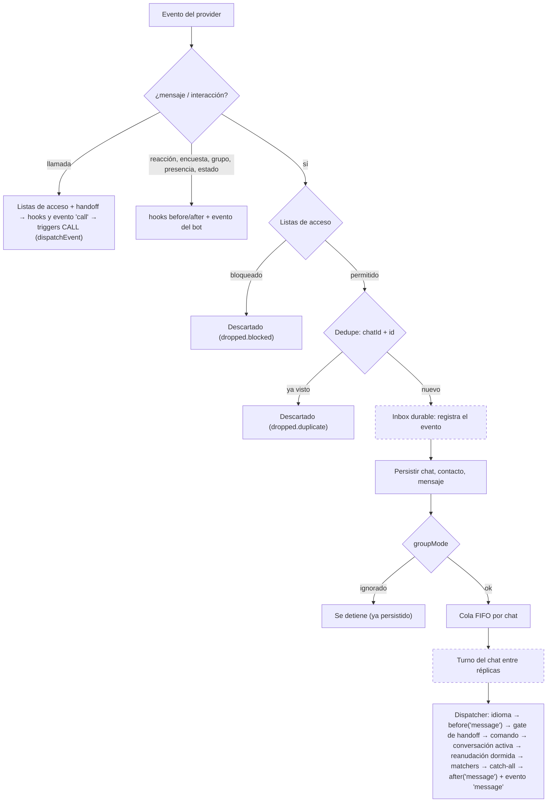
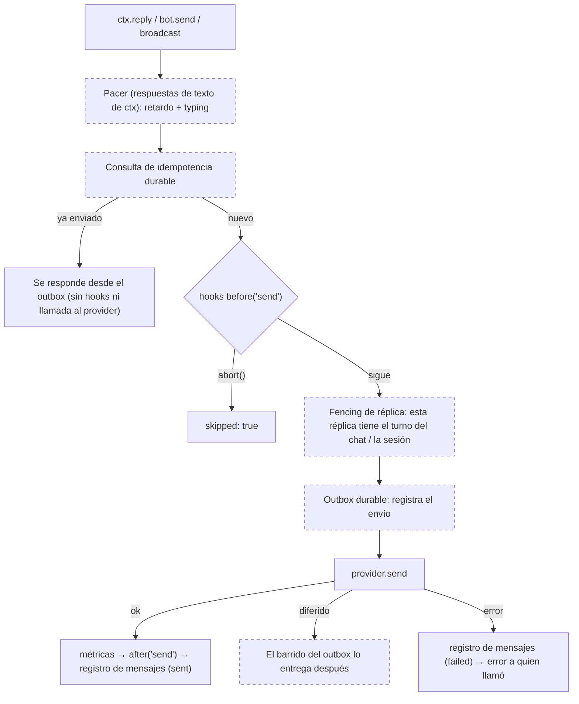
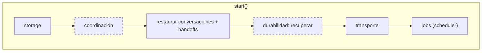

# Arquitectura

Cómo está montado `@bot-wa/core`: las capas de paquetes, los módulos que hay detrás de
la clase `Bot`, el camino de un mensaje de entrada y de salida, y dónde se enchufan
las funciones opcionales (durabilidad, coordinación entre réplicas, scheduler durable,
trazas). No necesitas nada de esto para escribir un bot. Es para quien extiende el
core, escribe un canal o un store, o depura lo que pasa entre el provider y un handler.

## Capas

El framework es un monorepo pnpm. Las dependencias solo van **hacia abajo**:

| Capa | Paquetes |
| --- | --- |
| Motor | `@bot-wa/core` (su única dependencia runtime es `pino`) |
| Infra compartida | `@bot-wa/http` (cliente anti-SSRF), `@bot-wa/graph-core` (helpers de Meta Graph) |
| Canales | `@bot-wa/baileys`, `@bot-wa/meta`, `@bot-wa/telegram`, … (cada uno implementa `IProvider`) |
| Stores | `@bot-wa/sqlite-store`, `@bot-wa/redis-store`, … (cada uno implementa `IStore`) |
| Plugins / producto | `@bot-wa/ai`, `nlu`, `manager`, `inbox`, … |

El core es **agnóstico de transporte**. No sabe nada de JIDs, códigos QR ni webhooks:
los ids de chat, usuario y mensaje son strings opacos que nunca parsea, y el provider
resuelve los alias de identidad (LID/PN en WhatsApp, `sender_chat` en Telegram)
**antes** de emitir el evento, así que la misma persona llega siempre con el mismo
`senderId`. Todo lo específico de un canal vive en el paquete del canal.

## Dentro del `Bot`

`Bot` es una **fachada** fina: sus métodos llevan la documentación pública y delegan.
El motor vive en `packages/core/src/core/bot/`:

| Módulo | Responsabilidad |
| --- | --- |
| `compose.ts` | El cuerpo del constructor: valores por defecto, logger, store + namespace y cada subsistema, en un orden fijo; construye el kernel y los módulos de abajo |
| `kernel.ts` | `BotKernel`, los internos compartidos (subsistemas + estado del ciclo de vida) que recibe cada módulo, más pequeños helpers comunes |
| `lifecycle.ts` | `start()` / `stop()` como una lista ordenada de pasos, con rollback y drenado |
| `inbound.ts` | El flujo de eventos del provider → listas de acceso → dedupe → persistencia → `groupMode` → Dispatcher; llamadas y eventos del provider (reacciones, recibos…) |
| `outbound.ts` | Envíos y ediciones por los hooks de `send`, el registro de mensajes, respuestas pausadas, typing y `ctx.stream()` |
| `contextFactory.ts` | Construye el `MessageContext` (`ctx`) de un mensaje, una llamada proyectada o un `bot.trigger()` |
| `gates.ts` | Admisión por listas de acceso y handoff a humano, con sus contadores y logs de descarte |
| `lang.ts` | La resolución de `ctx.lang` y los puntos de idioma del Dispatcher |
| `persistence.ts` | Escrituras de chat / contacto / handoff, ordenadas por chat |
| `events.ts` | La salida de errores y eventos de observabilidad |
| `routes.ts` | `when`, `conversation`, `command`, `onMessage`, `onType`, hooks |
| `pluginHost.ts` | `plug()`: un bot acotado cuyos registros se deshacen al desenchufar |
| `ops.ts` | `trigger`, `triggerFlow`, `broadcast`, métricas, inventario de flujos, colaboradores de datos de sujeto |

Tres reglas lo mantienen en pie:

- **Sin campos `#private` en `Bot`.** Un plugin recibe `Object.create(bot)` como
  `ctx.bot`; sus métodos corren con `this` apuntando a ese objeto, y leer un
  `#private` a través de él lanzaría. Al kernel se llega por `this`, o sea, por el
  prototipo.
- **Enlaces tardíos.** Los módulos llaman de vuelta al bot con closures (`bot.emit`,
  `bot.trigger`, `bot.isHandedOff`…) que se leen en el momento de la llamada, así que
  se respeta un spy, un override de subclase o el de un bot de plugin instalado después.
- **El comportamiento va en un módulo, no en la fachada.** Cada módulo tiene menos de
  500 líneas y abre con un comentario que dice qué hace y qué no.

## Pipeline de entrada

Las cajas punteadas solo existen cuando su función está configurada.

Las etapas de enrutado dentro del Dispatcher, en orden, están en
[Conceptos básicos](/es/guide/conceptos). Dos entradas se saltan parte de este camino:
las **llamadas** pasan por las mismas listas de acceso y el handoff y solo llegan a
triggers de tipo `CALL`, y **`bot.trigger()`** pasa por las listas de acceso, toma el
turno del chat en la cola (`runExclusive`), el gate de handoff y la resolución de
idioma, y arranca la conversación directamente: sin dedupe, persistencia, hooks de
mensaje ni matchers.

## Pipeline de salida

`ctx.edit()` sigue el mismo camino con `edit` en el payload del hook. Las vistas
previas en vivo de `ctx.stream()` (borradores y ediciones en el sitio) solo corren los
hooks `before('send')`; los mensajes que el stream envía al final siguen el camino
completo. `bot.enqueue()` (solo con durabilidad) corre los hooks `before('send')`,
registra el envío y vuelve enseguida; lo entrega el barrido del outbox.

## Ciclo de vida

`stop()` cierra la entrada y cancela los broadcasts, detiene o pausa los pasos que
producen trabajo nuevo (scheduler, barrido de durabilidad), opcionalmente drena los
envíos en curso (`stop({ drain: true })`), cierra los envíos pausados y aborta las
conversaciones (los checkpoints se conservan), y después detiene el resto de pasos en
orden inverso. Si `start()` falla, los pasos ya arrancados se deshacen en orden
inverso y el error se relanza.

Una función opcional añade un **paso de ciclo de vida**; no reparte `if`s por el código
de arranque y parada.

## Dónde se enchufan las funciones opcionales

Todas vienen apagadas. Un bot que no las configura corre exactamente el camino
descrito arriba sin las cajas punteadas.

| Función | Config | Etapas que toca | Guía |
| --- | --- | --- | --- |
| Procesamiento durable | `durability` | Entrada: registra cada evento en un **inbox** antes de despacharlo y lo confirma cuando el trabajo que inició termina; lo reproduce tras una caída. Salida: consulta de idempotencia y un registro en el **outbox** por envío, con reintentos y cola de muertos. Ciclo de vida: un paso `durability` | [Procesamiento durable](/es/guide/durabilidad) |
| Coordinación entre réplicas | `coordination` | Entrada: cada chat se procesa bajo un **turno** entre réplicas, en orden de llegada. Salida: un **fencing** rechaza envíos de una réplica que perdió su turno o la sesión del provider. Ciclo de vida: un paso `coordination` y elección de líder para transportes exclusivos. Con `coordination.handover`, los checkpoints de flow guardan la respuesta de un paso cortado y los flows no persistentes pueden pasar a otra réplica | [Varias réplicas](/es/guide/replicas) |
| Scheduler durable | `scheduler` | Jobs: las tareas con `id` se guardan, sobreviven a reinicios con una política de ejecuciones perdidas y cada ocurrencia corre en una sola réplica (un **lease**) | [Scheduler](/es/guide/scheduler) |
| Trazas | `telemetry` | Envuelve en spans las etapas que observa sin cambiar su orden ni sus tiempos: evento del provider (`bot.inbound`), persistencia, despacho, handler, cada turno de conversación entre esperas, el pacing y cada envío; `@bot-wa/ai` añade spans de modelo y herramientas. `@bot-wa/otel` (fuera del core, con `@opentelemetry/api` como peer opcional) los exporta. Los jobs programados todavía no tienen span propio | [Trazas](/es/guide/trazas) |

## Ver también

- [Conceptos básicos](/es/guide/conceptos): el orden completo de enrutado y las conversaciones.
- [Hooks](/es/guide/hooks): los contratos de los hooks `message` y `send`.
- [Plugins](/es/guide/plugins): qué registra y deshace un bot de plugin.
