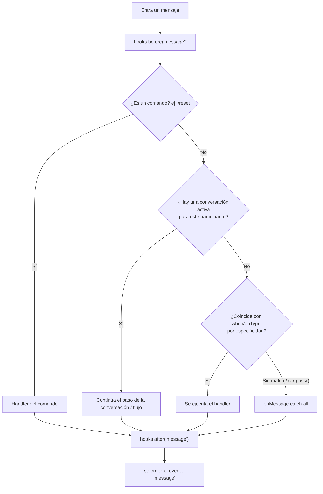

# Conceptos básicos

Entiende cómo el **Dispatcher** decide qué pasa con cada mensaje entrante, y
las piezas con las que compones un bot.

## El pipeline del Dispatcher

Todo mensaje entrante pasa por el mismo pipeline, en este orden. Lo primero
que **consume** el mensaje gana y detiene el pipeline:



1. **Los comandos** (`/reset`, `/help`, ...) siempre ganan — incluso sobre
   una conversación activa. Eso es lo que le permite a `/reset` escapar de
   un flujo atascado.
2. **Conversación activa** — si este participante ya inició un `flow` o un
   `bot.conversation` que está esperando una respuesta, el mensaje va ahí.
3. **Matchers** registrados con `bot.when(...)`, probados por especificidad
   (una coincidencia exacta de string/`equals` gana sobre un regex amplio o
   un handler de tipo de media como `onImage`).
4. **`bot.onMessage()`** — el catch-all, se ejecuta **solo** si nada de lo
   anterior consumió el mensaje.

Los handlers **consumen por defecto**: una vez que uno se ejecuta, el
pipeline se detiene ahí. Llama a `ctx.pass()` dentro de un handler para
ceder el turno al siguiente handler que coincida en lugar de detenerse —
así es como los handlers de baja especificidad como `onImage`/`onType`
cooperan con un `when` más amplio:

```ts
bot.when(/.+/, async (ctx) => {
  if (ctx.type === 'image') { ctx.pass(); return } // cede el turno al siguiente handler
  await ctx.reply('text received')
})

bot.onImage(async (ctx) => {
  await ctx.reply('image received') // ahora se alcanza, porque el handler de arriba hizo pass
})
```

### 1. Bot — el centro

```ts
const bot = new Bot({ session: 'my-bot' })
await bot.start()
```

El `Bot` es la instancia principal. Se conecta a WhatsApp, ejecuta el
Dispatcher, los hooks, los flujos y el scheduler.

### 2. when — respuestas simples

```ts
bot.when('hola', async (ctx) => {
  await ctx.reply('👋 Hello!')
})
```

**Cuando** el mensaje coincide con el trigger, ejecuta esta función. La
estrategia de coincidencia por defecto es **igualdad normalizada**:
minúsculas, sin acentos, espacios colapsados — `'hola'` coincide con
"hola"/"Hóla ", pero NO con "/hola" ni "hola amigo". Los triggers aceptan
texto, una lista, un regex, un predicado, o un objeto explícito
`{ pattern, match, scope }`:

```ts
bot.when('hola', handler)
bot.when(['bye', 'goodbye'], handler)
bot.when(/\d{4,}/, handler)
bot.when({ pattern: 'factura', match: 'contains' }, handler) // estilo v1: "contains"
```

### 3. flow / conversation — conversaciones multi-paso

```ts
const register = flow('registrar')
  .ask('Name?', 'name')
  .say((_ctx, c) => `Hi ${c.state.name}`)

bot.use(register)
```

Un **flow** compila a una conversación async real: el bot pregunta, el
usuario responde, `c.state` lo guarda y el flujo continúa — con
validación, reintentos, branching (`choose`) y timeouts. Para tener control
manual total puedes saltarte el DSL y escribir directamente
`bot.conversation(name, async (c, ctx) => {...})`.

### 4. Hooks — middleware (before / after / onError)

```ts
bot.before('message', async (ctx, next) => {
  console.log('📥', ctx.from, ctx.body)
  await next()
})

bot.after('message', async (ctx) => {
  console.log('📤 processed')
})

bot.onError('message', async (ctx, error) => {
  console.error('💥 error:', error)
})
```

Los hooks se ejecutan **antes** o **después** de cada mensaje, como el
middleware de Express. `'message'` es el evento principal de hooks;
`'send'` se dispara en cada envío saliente.

### 5. Plugins — funcionalidad empaquetada

```ts
bot.plug(slashCommandsPlugin, { greeting: 'Hi!' })
```

Un plugin es un paquete reutilizable que puede registrar hooks, handlers y
herramientas. `bot.plug()` devuelve una función `unplug()` que revierte
todo lo que registró.

## El evento `'message'` vs `onMessage()`

Se parecen pero no son lo mismo:

- `bot.on('message', ctx => ...)` se dispara para **todo** mensaje que el
  Dispatcher terminó de procesar — incluyendo los que un comando, una
  conversación activa, o un handler `when` ya consumieron.
- `bot.onMessage(ctx => ...)` es el **catch-all** — solo se ejecuta cuando
  nada más consumió el mensaje.

## Las conversaciones de grupo son por participante por defecto

En un grupo, dos participantes distintos que le hablan al bot en el mismo
chat obtienen **conversaciones independientes** por defecto (indexadas
internamente por `${from}:${sender}`). Usa `conversationScope: 'chat'` si
quieres una única conversación compartida por chat de grupo:

```ts
const bot = new Bot({ conversationScope: 'chat' })
```

## El objeto ctx — tu mejor amigo

```ts
bot.when('hola', async (ctx) => {
  console.log(ctx.body)        // texto del mensaje
  console.log(ctx.from)        // JID del chat
  console.log(ctx.sender)      // JID del remitente (= from en DMs, participant en grupos)
  console.log(ctx.type)        // 'text', 'image', 'audio', ...
  console.log(ctx.isGroup)     // ¿es un grupo?

  await ctx.reply('text')
  await ctx.photo(url, 'caption')
  await ctx.poll('Question?', ['A', 'B'])
  await ctx.react('👍')

  const db = ctx.tools.db  // herramienta inyectada
})
```

## ¿Qué es un JID?

Un **JID** (Jabber ID) es un identificador de chat de WhatsApp:

| Tipo | Formato | Ejemplo |
|---|---|---|
| Usuario | `number@s.whatsapp.net` | `573001234567@s.whatsapp.net` |
| Grupo | `id@g.us` | `120363xxx@g.us` |
| Newsletter | `id@newsletter` | `120363xxx@newsletter` |

No necesitas memorizar esto — `ctx.from` te da el JID correcto.

## Siguientes pasos

- [Mensajes y media](./mensajes) — todos los tipos de respuesta
- [Flujos conversacionales](./flujos) — conversaciones complejas
- [Hooks](./hooks) — middleware y logging
- [Ejemplos](/es/ejemplos/mensajes) — recetas prácticas
