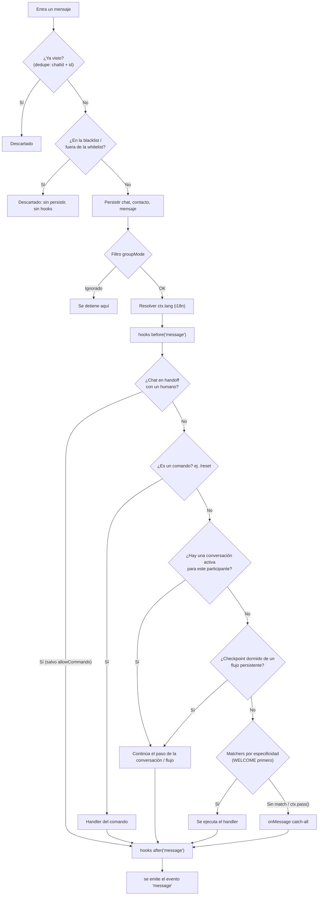

# Conceptos básicos

Entiende cómo el **Dispatcher** decide qué pasa con cada mensaje entrante, y
las piezas con las que compones un bot.

## El pipeline de entrada

Todo mensaje entrante pasa por el mismo pipeline, en este orden. Los cuatro
primeros pasos corren en el `Bot` en cuanto el provider emite el evento; el
resto corre dentro del Dispatcher, en una **cola FIFO por chat** (dos
mensajes del mismo chat nunca se procesan en paralelo). Lo primero que
**consume** el mensaje gana y detiene el enrutado:



1. **Dedupe de entrada**: un mensaje o interacción re-entregado (mismo
   `chatId` + id, por reintentos de webhook o por la resincronización
   offline de Baileys) se descarta antes que nada. Activado por defecto;
   ver [Dedupe de entrada](#dedupe-de-entrada).
2. **Blacklist / whitelist**: un remitente o chat bloqueado se descarta en
   silencio. No se persiste, no corren hooks y no se emite `'message'`. Ver
   [Handoff y listas de acceso](./handoff#blacklist-y-whitelist).
3. **Persistencia**: se guardan el chat, el contacto y el mensaje en el store.
4. **Filtro `groupMode`**: un mensaje de grupo que el bot debe ignorar se
   detiene aquí (sí se persiste).
5. **Resolución del idioma y hooks `before('message')`**: con el
   [i18n](./i18n) activado, primero se resuelve `ctx.lang` (preferencia
   guardada en `ctx.user` → idioma que informa el provider → `detect` →
   idioma por defecto), así que hooks y handlers ya lo ven. Después corren
   los hooks, que pueden hacer `abort()` del mensaje.
6. **Gate de handoff**: mientras un chat está [en manos de un humano](./handoff),
   se saltan los pasos 7–11 (salvo los comandos de `handoff.allowCommands`).
   El mensaje se sigue persistiendo, los hooks siguen corriendo y
   `'message'` se sigue emitiendo.
7. **Los comandos** (`/reset`, `/help`, ...) siempre ganan, incluso sobre
   una conversación activa. Eso es lo que le permite a `/reset` escapar de
   un flujo atascado.
8. **Conversación activa**: si este participante ya inició un `flow` o un
   `bot.conversation` que está esperando una respuesta, el mensaje va ahí.
9. **Reanudación dormida**: si un flujo `.persistent()` quedó guardado como
   checkpoint en el store (p. ej. antes de un reinicio), el flujo se reanuda
   en el paso guardado.
10. **Matchers** registrados con `bot.when(...)`, por especificidad: primero
    [`WELCOME`](./triggers#welcome) (solo el primer contacto), luego los
    triggers de texto (una coincidencia exacta/`equals` gana a
    `startsWith`, a un regex o a `contains`), luego las funciones
    predicado, luego los triggers de un tipo (`IMAGE`, `onImage`...) y por
    último los multi-tipo (`MEDIA`). Con la misma especificidad gana el
    registrado primero.
11. **`bot.onMessage()`**: el catch-all (también `aiPlugin`). Se ejecuta
    **solo** si nada de lo anterior consumió el mensaje.
12. **Cierre**: hooks `after('message')` y luego el evento `'message'` (aquí
    se rearman los temporizadores de `bot.onIdle`).

Las **llamadas** entrantes siguen un camino aparte: los mismos gates de
listas de acceso y handoff, la misma resolución del idioma y después solo
los [triggers `CALL`](./triggers#call). Sin hooks de mensaje, comandos ni
evento `'message'`.

`bot.trigger(name, { chatId })` (arrancar un flujo sin mensaje entrante)
también va por su propio camino: las listas de acceso, después el turno de
la cola FIFO del chat, el gate de handoff, la resolución del idioma y el
inicio de la conversación. Sin dedupe, persistencia, hooks de mensaje,
matchers ni evento `'message'`.

Si un handler lanza, corren los hooks `onError('message')` y el error se
emite siempre en `bot.on('error', ({ error, ctx }) => ...)`, aunque no haya
ningún hook de error registrado.

Los handlers **consumen por defecto**: una vez que uno se ejecuta, el
pipeline se detiene ahí. Llama a `ctx.pass()` dentro de un handler para
ceder el turno al siguiente handler que coincida en lugar de detenerse —
así es como los handlers de baja especificidad como `onImage`/`onType`
cooperan con un `when` más amplio:

```ts
bot.when(/.+/, async (ctx) => {
  if (ctx.type === 'image') { ctx.pass(); return } // cede el turno al siguiente handler
  await ctx.reply('text received')
})

bot.onImage(async (ctx) => {
  await ctx.reply('image received') // ahora se alcanza, porque el handler de arriba hizo pass
})
```

### 1. Bot + Provider — el centro

```ts
import { Bot } from '@bot-wa/core'
import { BaileysProvider } from '@bot-wa/baileys'

const bot = new Bot({ provider: new BaileysProvider({ session: 'my-bot' }) })
await bot.start()
```

El `Bot` (de `@bot-wa/core`) es el motor agnóstico de transporte: ejecuta
el Dispatcher, los hooks, los flujos, las conversaciones y el scheduler.
El **provider** es la frontera del transporte — `@bot-wa/baileys` se
conecta a WhatsApp; `@bot-wa/meta` (Cloud API oficial), `@bot-wa/telegram`
y los transportes experimentales de Messenger, Instagram y Discord se
enchufan al mismo motor. Todos los transportes
alimentan al bot con los mismos eventos normalizados.

### 2. when — respuestas simples

```ts
bot.when('hola', async (ctx) => {
  await ctx.reply('👋 Hello!')
})
```

**Cuando** el mensaje coincide con el trigger, ejecuta esta función. La
estrategia de coincidencia por defecto es **igualdad normalizada**:
minúsculas, sin acentos, espacios colapsados — `'hola'` coincide con
"hola"/"Hóla ", pero NO con "/hola" ni "hola amigo". Los triggers aceptan
texto, una lista, un regex, un predicado, o un objeto explícito
`{ pattern, match, scope }`:

```ts
bot.when('hola', handler)
bot.when(['bye', 'goodbye'], handler)
bot.when(/\d{4,}/, handler)
bot.when({ pattern: 'factura', match: 'contains' }, handler) // estilo v1: "contains"
```

### 3. flow / conversation — conversaciones multi-paso

```ts
const register = flow('registrar')
  .ask('Name?', 'name')
  .say((_ctx, c) => `Hi ${c.state.name}`)

bot.use(register)
```

Un **flow** compila a una conversación async real: el bot pregunta, el
usuario responde, `c.state` lo guarda y el flujo continúa — con
validación, reintentos, branching (`choose`) y timeouts. Para tener control
manual total puedes saltarte el DSL y escribir directamente
`bot.conversation(name, async (c, ctx) => {...})`.

### 4. Hooks — middleware (before / after / onError)

```ts
bot.before('message', async (ctx, next) => {
  console.log('📥', ctx.from, ctx.body)
  await next()
})

bot.after('message', async (ctx) => {
  console.log('📤 processed')
})

bot.onError('message', async (ctx, error) => {
  console.error('💥 error:', error)
})
```

Los hooks se ejecutan **antes** o **después** de cada mensaje, como el
middleware de Express. `'message'` es el evento principal de hooks;
`'send'` se dispara en cada envío saliente.

### 5. Plugins — funcionalidad empaquetada

```ts
bot.plug(slashCommandsPlugin, { greeting: 'Hi!' })
```

Un plugin es un paquete reutilizable que puede registrar hooks, handlers y
herramientas. `bot.plug()` devuelve una función `unplug()` que revierte
todo lo que registró.

## Dedupe de entrada

Los transportes por webhook (Cloud API, Messenger, Instagram, Telegram en
modo webhook) reintentan una entrega cuando no reciben un 2xx a tiempo, y
Baileys puede reenviar mensajes recientes al reconectar. Sin protección, un
mismo mensaje arrancaría un flujo dos veces o se consumiría como la
respuesta a la *siguiente* pregunta de una conversación. El `Bot` descarta
las re-entregas antes de que lleguen a ningún handler. Viene **activado por
defecto**:

```ts
new Bot({ provider })                                     // por defecto: { size: 1000 }, sin TTL
new Bot({ provider, dedupe: { size: 5000, ttl: '1h' } })  // ajustar
new Bot({ provider, dedupe: false })                      // desactivar
```

- La clave de un mensaje es `chatId` + `ref.id`, porque algunos transportes
  solo garantizan ids únicos por chat (p. ej. el `message_id` de Telegram).
  La de una interacción (pulsar un botón o una fila de lista) es su
  `interactionId`, así que dos pulsaciones en el mismo menú son dos eventos.
- Ediciones: el mismo id con **otro** cuerpo (`edited_message` de Telegram)
  se procesa; un reintento idéntico se descarta. Solo se guarda un hash del
  cuerpo, nunca el texto.
- Los eventos con id vacío nunca se deduplican.
- Si falla la persistencia antes de los handlers (store caído), la clave se
  libera y el reintento del transporte sí se procesa.
- `size` es un LRU; `ttl` (ms o `'30s'`/`'10m'`/`'1h'`) cuenta desde la
  primera aceptación.
- **Límite:** vive en la memoria del proceso. No deduplica entre réplicas
  ni tras un reinicio.

Los providers deben dar a cada evento entrante un id que nombre exactamente
un evento lógico, que no cambie cuando se re-entrega y que sea `''` cuando
el transporte no pueda garantizarlo. Es el **contrato de ids de entrada**,
documentado en `IProvider`. Avanzado: `@bot-wa/core` exporta
`InboundDeduper`, `createInboundDeduper`, `inboundDedupeKey` y
`DEFAULT_DEDUPE_SIZE`.

## El evento `'message'` vs `onMessage()`

Se parecen pero no son lo mismo:

- `bot.on('message', ctx => ...)` se dispara para **todo** mensaje que el
  Dispatcher terminó de procesar — incluyendo los que un comando, una
  conversación activa, o un handler `when` ya consumieron.
- `bot.onMessage(ctx => ...)` es el **catch-all** — solo se ejecuta cuando
  nada más consumió el mensaje.

## Las conversaciones de grupo son por participante por defecto

En un grupo, dos participantes distintos que le hablan al bot en el mismo
chat obtienen **conversaciones independientes** por defecto (indexadas
internamente por `${from}:${sender}`). Usa `conversationScope: 'chat'` si
quieres una única conversación compartida por chat de grupo:

```ts
const bot = new Bot({
  provider: new BaileysProvider({ session: 'my-bot' }),
  conversationScope: 'chat',
})
```

## El objeto ctx — tu mejor amigo

```ts
bot.when('hola', async (ctx) => {
  console.log(ctx.body)        // texto del mensaje
  console.log(ctx.from)        // id del chat (opaco; un JID en WhatsApp/Baileys)
  console.log(ctx.sender)      // id del remitente (= from en DMs, participant en grupos)
  console.log(ctx.type)        // 'text', 'image', 'audio', ...
  console.log(ctx.isGroup)     // ¿es un grupo?

  await ctx.reply('text')
  await ctx.photo(url, 'caption')
  await ctx.poll('Question?', ['A', 'B'])
  await ctx.react('👍')

  const db = ctx.tools.db  // herramienta inyectada
  await ctx.user.set('lang', 'es')   // perfil persistente por usuario
})
```

## Ids de chat y remitente

`ctx.from` (chat) y `ctx.sender` (usuario) son **strings opacos** que el
provider resuelve — el core nunca inspecciona su forma. Para el transporte
Baileys resultan ser **JIDs** (Jabber IDs) de WhatsApp:

| Tipo | Formato | Ejemplo |
|---|---|---|
| Usuario | `number@s.whatsapp.net` | `573001234567@s.whatsapp.net` |
| Grupo | `id@g.us` | `120363xxx@g.us` |
| Newsletter | `id@newsletter` | `120363xxx@newsletter` |

No necesitas memorizar esto — `ctx.from` te da el id correcto en cualquier
transporte. Si necesitas la clave nativa del mensaje entrante (para
citarlo/editarlo/borrarlo con llamadas del provider), usa `ctx.ref`
(`{ id, chatId, native? }`).

## Siguientes pasos

- [Mensajes y media](./mensajes) — todos los tipos de respuesta
- [Flujos conversacionales](./flujos) — conversaciones complejas
- [Hooks](./hooks) — middleware y logging
- [Triggers especiales](./triggers) — WELCOME, tipos de mensaje y CALL
- [Handoff y listas de acceso](./handoff) — pausar el bot para un humano, bloquear remitentes
- [Ejemplos](/es/ejemplos/mensajes) — recetas prácticas
