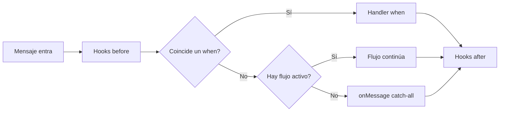

# Conceptos básicos

Entiende las 5 piezas que componen bot-wa-baileys. Una vez que las entiendas,
todo lo demás son variaciones de estas.

## Las 5 piezas



### 1. Bot — el centro de todo

```js
const bot = new Bot({ session: 'mi-bot' })
await bot.start()
```

El `Bot` es la instancia principal. Conecta con WhatsApp, enruta mensajes,
ejecuta hooks y maneja flujos. Todo cuelga de él.

### 2. when — respuestas simples

```js
bot.when('hola', async (ctx) => {
  await ctx.reply('👋 ¡Hola!')
})
```

**Cuando** alguien envía un mensaje que contiene "hola", ejecuta esta función.
Es la forma más simple de responder. Acepta texto, regex o listas:

```js
bot.when('hola', handler)                    // texto
bot.when(['adios', 'chao', 'bye'], handler)  // lista
bot.when(/\d{4,}/, handler)                  // regex (números largos)
```

### 3. flow — conversaciones multi-paso

```js
const registro = flow('registrar')
  .say('¿Nombre?', { capture: true })
  .do(async (ctx, { state }) => state.set('nombre', ctx.body))
  .say(async (ctx, { state }) => `Hola ${state.get('nombre')}`)
  .end()

bot.use(registro)
```

Un **flujo** es una conversación con pasos. El bot pregunta, el usuario
responde, el bot guarda la respuesta y continúa. Tiene captura, validación,
branching, timeout y fallback.

### 4. Hooks — middleware (before / after / onError)

```js
bot.before('message', async (ctx, next) => {
  console.log('📥', ctx.from, ctx.body)
  await next()  // importante: llama next() para continuar
})

bot.after('message', async (ctx) => {
  console.log('📤 procesado')
})

bot.onError('message', async (ctx, error) => {
  console.error('💥 error:', error)
})
```

Los hooks se ejecutan **antes** o **después** de cada mensaje. Sirven para
logging, rate limiting, métricas, autenticación, etc. Son como el middleware
de Express.

### 5. Plugins — funcionalidad empaquetada

```js
bot.plug(slashCommandsPlugin, { greeting: '¡Hola!' })
```

Un plugin es un paquete reutilizable que puede registrar hooks, handlers,
herramientas o lo que sea. `slashCommandsPlugin` viene incluido y agrega
`/start`, `/help`, `/reset`, `/id`, `/ping`.

## El objeto ctx — tu mejor amigo

Cada handler y hook recibe un `ctx` (contexto del mensaje). Tiene todo lo
que necesitas:

```js
bot.when('hola', async (ctx) => {
  // Información del mensaje
  console.log(ctx.body)        // texto del mensaje
  console.log(ctx.from)        // JID del remitente
  console.log(ctx.type)        // 'text', 'image', 'audio', ...
  console.log(ctx.isGroup)     // ¿es un grupo?
  console.log(ctx.sender)     // { id, pushName }

  // Responder
  await ctx.reply('texto')                    // texto
  await ctx.photo(url, 'caption')              // foto
  await ctx.voice(url)                        // nota de voz
  await ctx.sticker(url, { pack, author })     // sticker
  await ctx.location(lat, lng, name)          // ubicación
  await ctx.contact(phone, name)              // contacto
  await ctx.poll(question, options)           // encuesta
  await ctx.react('👍')                       // reacción
  await ctx.quote('respondiendo a tu mensaje') // citando

  // Herramientas inyectadas (DI)
  const db = ctx.tools.db
  await db.touch(ctx.from)
})
```

## ¿Qué es un JID?

Un **JID** (Jabber ID) es el identificador de un chat en WhatsApp:

| Tipo | Formato | Ejemplo |
|---|---|---|
| Usuario | `numero@s.whatsapp.net` | `573001234567@s.whatsapp.net` |
| Grupo | `id@g.us` | `120363xxx@g.us` |
| Newsletter | `id@newsletter` | `120363xxx@newsletter` |
| Broadcast | `status@broadcast` | `status@broadcast` |

No necesitas memorizar esto — `ctx.from` ya te da el JID correcto.

## Siguientes pasos

- [Mensajes y media](./mensajes) — todos los tipos de respuesta
- [Flujos conversacionales](./flujos) — conversaciones complejas
- [Hooks](./hooks) — middleware y logging
- [Ejemplos](/es/ejemplos/mensajes) — recetas prácticas