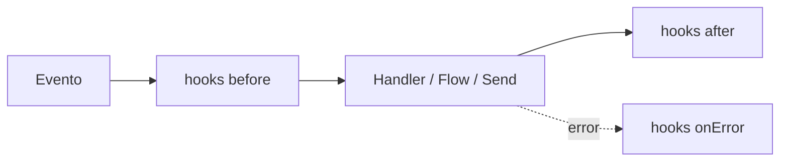

# Hooks (middleware)

Los hooks son funciones que se ejecutan **antes** o **después** de un
evento. Como el middleware de Express: interceptan, modifican, deciden si
continuar.

## Los 3 tipos



### before — antes de procesar

```ts
bot.before('message', async (ctx, next) => {
  console.log('📥', ctx.from, ':', ctx.body)
  await next()  // ← importante: llama next() para continuar
})
```

::: warning No olvides next()
Si no llamas `next()` (o llamas a `ctx.abort()`), el mensaje **no se sigue
procesando**. Útil para bloquear mensajes (rate limiting, filtros).
:::

### after — después de procesar

```ts
bot.after('message', async (ctx) => {
  console.log('📤 processed:', ctx.type)
})
```

### onError — cuando algo falla

```ts
bot.onError('message', async (ctx, error) => {
  console.error('💥 error:', error)
  if (ctx) await ctx.reply('😅 An error occurred. Try again.')
})
```

También existe un `bot.hook(event, phase, handler, priority?)` genérico si
necesitas registrar una fase dinámicamente en lugar de llamar directamente a
`before`/`after`/`onError`.

## Casos de uso

### Logging

```ts
bot.before('message', async (ctx, next) => {
  console.log(`📥 [${new Date().toISOString()}] ${ctx.from}: ${ctx.body}`)
  await next()
})
```

### Rate limiting

```ts
const counts = new Map()

bot.before('message', async (ctx, next) => {
  const now = Date.now()
  let entry = counts.get(ctx.from)

  if (!entry || entry.resetAt < now) {
    entry = { count: 0, resetAt: now + 60000 }
    counts.set(ctx.from, entry)
  }

  entry.count++
  if (entry.count > 10) {
    await ctx.reply('⏳ Too many messages. Wait a minute.')
    ctx.abort()
    return
  }

  await next()
})
```

### Filtrar grupos

```ts
bot.before('message', async (ctx, next) => {
  if (ctx.isGroup) return
  await next()
})
```

### Bloquear usuarios

```ts
const blocked = new Set(['57300XXXXXXX@s.whatsapp.net'])

bot.before('message', async (ctx, next) => {
  if (blocked.has(ctx.from)) {
    ctx.abort()
    return
  }
  await next()
})
```

## Transformar o bloquear mensajes salientes

`'send'` se dispara en **cada** envío saliente, ya sea que venga de
`ctx.reply`/`ctx.photo`/... o de `bot.send`/`bot.sendText`. El payload es
`{ chatId, content, options }` — `content` es el `OutboundContent` neutral
de transporte (`{ kind: 'text', text }`, `{ kind: 'image', media,
caption }`, ...); mútalo para transformar un mensaje, o aborta para
saltarte el envío por completo:

```ts
bot.before('send', async (payload, next) => {
  console.log('📤 sending to', payload.chatId, payload.content)
  await next()
})
```

## abort() — detener el pipeline

```ts
bot.before('message', async (ctx, next) => {
  if (someCondition) {
    ctx.abort()
    return
  }
  await next()
})
```

## Prioridad

```ts
bot.before('message', handler, 10)  // mayor = se ejecuta primero
bot.before('message', handler, 0)   // valor por defecto
```

## Eventos disponibles

| Evento | Cuándo |
|---|---|
| `message` | El pipeline principal — un mensaje entrante siendo procesado |
| `send` | Cualquier mensaje saliente, desde un helper de respuesta de `ctx` o `bot.send*` |

Los eventos de conexión a nivel de provider (`qr`, `ready`, `connection`,
...) son listeners `bot.on(...)` normales, no fases de hooks — ver
[Conceptos básicos](./conceptos).

## Siguientes pasos

- [Plugins](./plugins) — empaquetar hooks para reutilizar
- [Ejemplo: rate limiter](/es/ejemplos/rate-limiter) — plugin completo
