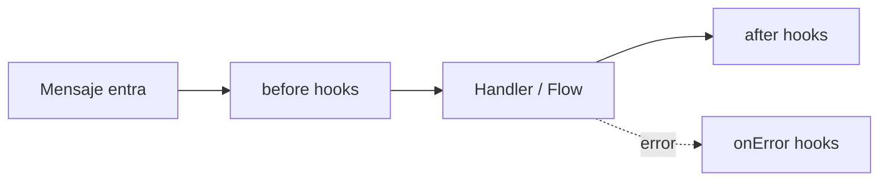

# Hooks (middleware)

Los hooks son funciones que se ejecutan **antes** o **después** de cada
mensaje. Son como el middleware de Express: interceptan, modifican y
deciden si continuar.

## Los 3 tipos



### before — antes de procesar

```js
bot.before('message', async (ctx, next) => {
  console.log('📥', ctx.from, ':', ctx.body)
  await next()  // ← importante: llama next() para continuar
})
```

::: warning No olvides next()
Si no llamas `next()`, el mensaje **no se procesa**. Útil para bloquear
mensajes (rate limiting, filtros, etc.).
:::

### after — después de procesar

```js
bot.after('message', async (ctx) => {
  console.log('📤 procesado:', ctx.type)
  // No hay next() — after es terminal
})
```

### onError — cuando algo falla

```js
bot.onError('message', async (ctx, error) => {
  console.error('💥 error:', error)
  if (ctx) await ctx.reply('😅 Ocurrió un error. Intenta de nuevo.')
})
```

## Casos de uso

### Logging de todos los mensajes

```js
bot.before('message', async (ctx, next) => {
  console.log(`📥 [${new Date().toISOString()}] ${ctx.from}: ${ctx.body}`)
  await next()
})
```

### Rate limiting (limitar mensajes por usuario)

```js
const counts = new Map()

bot.before('message', async (ctx, next) => {
  const now = Date.now()
  let entry = counts.get(ctx.from)

  if (!entry || entry.resetAt < now) {
    entry = { count: 0, resetAt: now + 60000 }  // ventana de 60s
    counts.set(ctx.from, entry)
  }

  entry.count++
  if (entry.count > 10) {
    await ctx.reply('⏳ Estás enviando muchos mensajes. Espera un minuto.')
    ctx.abort()  // ← detiene el pipeline
    return      // ← no llames next()
  }

  await next()
})
```

### Filtrar mensajes de grupos

```js
bot.before('message', async (ctx, next) => {
  if (ctx.isGroup) return  // ignorar grupos
  await next()
})
```

### Métricas

```js
bot.after('message', async (ctx) => {
  // En producción: enviar a Datadog, Prometheus, etc.
  console.log(`📤 procesado de ${ctx.from} (tipo: ${ctx.type})`)
})
```

### Bloquear usuarios

```js
const blocked = new Set(['57300XXXXXXX@s.whatsapp.net'])

bot.before('message', async (ctx, next) => {
  if (blocked.has(ctx.from)) {
    ctx.abort()
    return
  }
  await next()
})
```

## abort() — detener el pipeline

```js
bot.before('message', async (ctx, next) => {
  if (algunaCondicion) {
    ctx.abort()  // detiene el pipeline
    return       // no llames next()
  }
  await next()
})
```

`abort()` marca el contexto como abortado. Los hooks y handlers posteriores
no se ejecutan.

## Prioridad

```js
bot.before('message', handler, 10)  // prioridad 10 (mayor = primero)
bot.before('message', handler, 0)   // prioridad 0 (default)
```

Los hooks con mayor prioridad se ejecutan primero.

## Eventos disponibles

| Evento | Cuándo |
|---|---|
| `message` | Mensaje entrante |
| `send` | Mensaje saliente |
| `connection` | Cambio de conexión |
| `group` | Evento de grupo (join, leave, promote) |
| `call` | Llamada entrante |
| `presence` | Cambio de presencia |
| `reaction` | Reacción a un mensaje |
| `poll` | Voto en encuesta |

## Siguientes pasos

- [Plugins](./plugins) — empaquetar hooks reutilizables
- [Ejemplo: rate limiter](/es/ejemplos/rate-limiter) — plugin completo