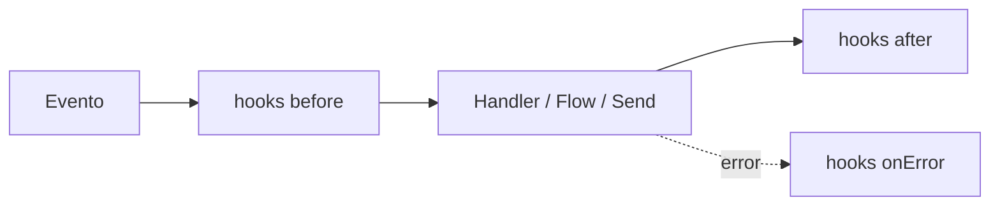

# Hooks (middleware)

Los hooks son funciones que se ejecutan **antes** o **después** de un
evento. Como el middleware de Express: interceptan, modifican, deciden si
continuar.

## Los 3 tipos



### before — antes de procesar

```ts
bot.before('message', async (ctx, next) => {
  console.log('📥', ctx.from, ':', ctx.body)
  await next()  // ← importante: llama next() para continuar
})
```

::: warning Olvidar next() bloquea el evento
Un hook `before` que vuelve **sin llamar a `next()`** detiene la cadena y el
evento, igual que `ctx.abort()`: el mensaje no se enruta (un `'send'` se
omite, un evento del provider no se emite). Un hook que solo observa o
reescribe debe terminar siempre con `await next()`. Para bloquear a
propósito (rate limiting, filtros), vuelve sin `next()` o llama a
`ctx.abort()` (ver `abort()` más abajo); `abort()` se lee más explícito.
:::

### after — después de procesar

```ts
bot.after('message', async (ctx) => {
  console.log('📤 processed:', ctx.type)
})
```

### onError — cuando algo falla

```ts
bot.onError('message', async (ctx, error) => {
  console.error('💥 error:', error)
  if (ctx) await ctx.reply('😅 An error occurred. Try again.')
})
```

También existe un `bot.hook(event, phase, handler, priority?)` genérico si
necesitas registrar una fase dinámicamente en lugar de llamar directamente a
`before`/`after`/`onError`.

El error de un handler se emite **siempre** en `bot.on('error', ({ error, ctx }) => ...)`,
haya o no un hook `onError('message')` registrado.

## Casos de uso

### Logging

```ts
bot.before('message', async (ctx, next) => {
  console.log(`📥 [${new Date().toISOString()}] ${ctx.from}: ${ctx.body}`)
  await next()
})
```

### Rate limiting

```ts
const counts = new Map()

bot.before('message', async (ctx, next) => {
  const now = Date.now()
  let entry = counts.get(ctx.from)

  if (!entry || entry.resetAt < now) {
    entry = { count: 0, resetAt: now + 60000 }
    counts.set(ctx.from, entry)
  }

  entry.count++
  if (entry.count > 10) {
    await ctx.reply('⏳ Too many messages. Wait a minute.')
    ctx.abort()
    return
  }

  await next()
})
```

### Filtrar grupos

```ts
bot.before('message', async (ctx, next) => {
  if (ctx.isGroup) return  // sin next(): el mensaje se detiene aquí (igual que ctx.abort())
  await next()
})
```

Para mensajes de grupo suele ser más simple la opción integrada
[`groupMode`](./conceptos#el-pipeline-de-entrada), que filtra antes incluso de que corran los hooks.

### Bloquear usuarios

```ts
const blocked = new Set(['57300XXXXXXX@s.whatsapp.net'])

bot.before('message', async (ctx, next) => {
  if (blocked.has(ctx.from)) {
    ctx.abort()
    return
  }
  await next()
})
```

Para una lista de bloqueo de verdad usa `bot.blacklist` / `bot.whitelist`:
descartan el mensaje antes incluso de persistirlo y también cubren botones y
llamadas. Ver [Handoff y listas de acceso](./handoff#blacklist-y-whitelist).

## Transformar o bloquear mensajes salientes

`'send'` se dispara en **cada** envío saliente, ya sea que venga de
`ctx.reply`/`ctx.photo`/... o de `bot.send`/`bot.sendText`. El payload es
`{ chatId, content, options }` — `content` es el `OutboundContent` neutral
de transporte (`{ kind: 'text', text }`, `{ kind: 'image', media,
caption }`, ...); mútalo para transformar un mensaje, o aborta para
saltarte el envío por completo:

```ts
bot.before('send', async (payload, next) => {
  console.log('📤 sending to', payload.chatId, payload.content)
  await next()
})
```

Un envío abortado resuelve `{ skipped: true }` en lugar de rechazar (una
[difusión](./mensajes#difusiones-broadcast) lo cuenta como `skipped`).

### Ediciones y salida en streaming

Algunos payloads llevan una marca para que un hook los distinga de un envío normal:

| Marca | Lo envía | Hooks que corren |
| --- | --- | --- |
| `edit: ref` | [`ctx.edit()`](./mensajes#editar-un-mensaje) al editar un mensaje en el sitio | `before` + `after` |
| `stream: 'message'` | un mensaje nuevo que envía [`ctx.stream()`](./streaming) (el primero de un stream por ediciones, un trozo por frases, el mensaje final tras los borradores) | `before` + `after` |
| `stream: 'edit'` | una actualización en vivo de un mensaje en streaming | solo `before` |
| `stream: 'draft'` | una vista previa nativa como borrador (Telegram) | solo `before` |

Un hook puede reescribir `payload.content` o hacer `abort()` en cualquiera de ellos.
Una edición abortada resuelve `skipped` y no envía un mensaje nuevo en su lugar.
Una edición degradada (el provider no puede editar) sale como un envío normal, sin `edit`.

```ts
let sentCount = 0
bot.before('send', async (payload, next) => {
  // Oculta números de tarjeta en todo, vistas previas incluidas
  if (payload.content.kind === 'text') {
    payload.content.text = payload.content.text.replace(/\b\d{13,16}\b/g, '[card]')
  }
  // Cuenta solo mensajes nuevos: las vistas previas repiten el mismo texto muchas veces
  if (payload.stream !== 'draft' && payload.stream !== 'edit' && !payload.edit) sentCount++
  await next()
})
```

## abort() — detener el pipeline

`abort()` detiene los hooks `before` restantes y el propio evento. Volver sin
`next()` tiene el mismo efecto; `abort()` sirve además desde código que no
tiene `next` a mano (un helper que solo recibe `ctx`).

```ts
bot.before('message', async (ctx, next) => {
  if (someCondition) {
    ctx.abort()
    return
  }
  await next()
})
```

## Prioridad

```ts
bot.before('message', handler, 10)  // mayor = se ejecuta primero
bot.before('message', handler, 0)   // valor por defecto
```

## Eventos disponibles

| Evento | Cuándo |
|---|---|
| `message` | El pipeline principal — un mensaje entrante siendo procesado |
| `send` | Cualquier mensaje saliente, desde un helper de respuesta de `ctx` o `bot.send*` (también ediciones y salida en streaming, ver arriba) |
| `reaction`, `poll`, `group`, `presence`, `status` | Eventos del provider (una reacción, un voto de encuesta, un cambio de grupo, presencia, un acuse de entrega/lectura): corren los hooks `before` y `after` y luego el evento `bot.on(...)` correspondiente. Un hook `before` que aborta (o no llama a `next()`) suprime los hooks `after` y el evento |
| `call` | Una llamada entrante. `before('call', (ev) => ev.abort())` la aparta de los [triggers `CALL`](./triggers#call), de los hooks `after('call')` y del evento `'call'` |

Los eventos de conexión a nivel de provider (`qr`, `ready`, `connection`,
...) son listeners `bot.on(...)` normales, no fases de hooks — ver
[Conceptos básicos](./conceptos). Lo mismo vale para
`'conversation:started'` / `'conversation:ended'`
(ver [Operación](./operations#eventos-de-conversacion)).

## Siguientes pasos

- [Plugins](./plugins) — empaquetar hooks para reutilizar
- [Ejemplo: rate limiter](/es/ejemplos/rate-limiter) — plugin completo
