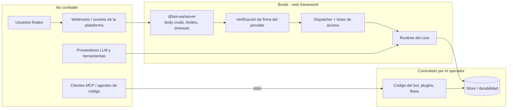

# Modelo de amenazas

Qué protege este framework, de quién, y qué **no** protege. El safety gate de
[`ROADMAP.md`](https://github.com/andresayac/bot-wa-baileys/blob/main/ROADMAP.md) exige que
este documento y su [checklist de release](https://github.com/andresayac/bot-wa-baileys/blob/main/CONTRIBUTING.md#checklist-de-release)
estén al día; los hallazgos por superficie, los arreglos y los riesgos residuales viven en
[Seguridad](seguridad.md).

## Activos

| Activo | Por qué importa | Dónde vive |
| --- | --- | --- |
| Credenciales de sesión | Una sesión de WhatsApp/Telegram/IMAP **es** la cuenta: filtrarla entrega la identidad | `sessions/`, `*_sessions/`, config del provider, `baileys_store.json` |
| Secretos del bot | Tokens de proveedor, API keys, secretos de webhook, app secrets | Entorno/`.env`, config del provider, `BotConfig` |
| Contenido y media de los mensajes | Datos personales de los usuarios finales (cuerpos, captions, adjuntos, ubicaciones) | Store, checkpoints, journal, logs, trazas |
| Datos operativos | Configs multi-tenant, destinatarios de campañas, notas de inbox, gate runs | `manager`, `deployments`, `inbox`, `crm`, `campaigns`, `hub` |
| Fronteras entre tenants | Un cliente nunca debe leer ni manejar el bot de otro | Namespaces, claves del store, REST `/v1`, `tenant-kv` |
| Disponibilidad del bot | Un bot colgado o inundado es una caída de negocio y, en WhatsApp, riesgo de baneo | Ingress, colas del dispatcher, rate limiter |

## Fronteras de confianza

Confiable: el código del bot, los plugins y los flows del operador, y la máquina donde corre
el proceso. No confiable: cada payload de plataforma, cada mensaje de usuario, cada respuesta
del modelo, cada byte descargado de una URL que venga de un payload y cualquier cliente MCP
que hable con `@bot-wa/mcp`.

## Amenazas y controles

| # | Amenaza | Superficie | Control | Riesgo residual |
| --- | --- | --- | --- | --- |
| T1 | Webhook falsificado (mensaje o llamada falsos) | 13 canales | Firma de la plataforma sobre el body **crudo**, comparación en tiempo constante, el provider no arranca sin credenciales | Replay donde la plataforma no firma timestamp (ver abajo) |
| T2 | Inundación / body gigante | Ingress de webhooks | `@bot-wa/server` acota tamaño, pone timeout por body y por ingest, limita concurrencia, `413`/`408`/`503` | El operador sigue dimensionando el proceso y el proxy |
| T3 | SSRF desde una URL del usuario (media, TTS, embeddings) | Toda descarga saliente | `secureFetch`: HTTPS, rangos privados rechazados, socket fijado a la IP verificada, redirects revalidados, topes de tamaño y tiempo | La respuesta DNS puede cambiar después solo si un provider se salta `secureFetch` |
| T4 | Path traversal vía ids (tenant, bot, chat, flow) | REST `/v1`, manager, docs del MCP | Ids restringidos a `[A-Za-z0-9][A-Za-z0-9_.:-]{0,63}`, nombres de archivo derivados, rutas de docs resueltas y rechazadas fuera de la raíz | Ninguno conocido |
| T5 | Ejecución de código desde un flujo almacenado | Documentos JSON de flujo | Esquema de datos: sin código, sin imports, sin `eval`; gramática de expresiones segura (sin regex, sin acceso al prototipo, con topes de longitud/profundidad); el paso `http` pasa por `secureFetch` | Un paso `http` puede llamar a un endpoint público que el operador permitió |
| T6 | Lectura/escritura entre tenants | Store, manager, paquetes de producto | Namespace por bot, claves por tenant en `tenant-kv`, compare-and-set, scopes del REST y `404` para otros tenants | Un `IStore` propio puede romper su propia aislamiento |
| T7 | Secretos o datos personales en logs/trazas | Logger, OpenTelemetry | El framework no registra cuerpos, prompts, payloads de QR ni tokens; los spans llevan ids según la política `ids` (`hash` por defecto) y nunca contenido | Código del operador que registre `ctx.body` |
| T8 | Inyección de prompt que maneja herramientas | `@bot-wa/ai` | Las herramientas se eligen por llamada, las destructivas exigen `confirm: true`, el modelo no puede inventar ids (`tools: ['id']` filtra el conjunto configurado) | Una herramienta de solo lectura puede filtrar lo que el operador le dio |
| T9 | Código no confiable dentro del proceso | Plugins | `Plugin.install` es síncrono, el plugin solo recibe la fachada con scope, sin sandbox | **Los plugins corren en el proceso con permisos de Node: instala solo código que confíes** |
| T10 | Baneo del número de WhatsApp | Baileys / gateways | Rate limiter opt-in, typing/pacing, sin spam de botones, `exclusiveSession` en transportes de conexión única | Automatizar WhatsApp Web es no oficial y siempre conlleva riesgo de baneo |
| T11 | Un agente lee o escribe lo que no debe | `@bot-wa/mcp` | Solo stdio local (sin listener de red), herramientas de solo lectura, sin `eval`, lectura de docs confinada a la raíz configurada, sin escrituras a disco | El cliente decide qué hace con las respuestas |
| T12 | Replay de un webhook capturado | Meta, Telegram, Twilio, HighLevel, Gupshup, WPPConnect | Dedupe por id de plataforma en memoria + ventana respaldada por el store | No hay timestamp de plataforma para imponer una ventana; mantén los endpoints en HTTPS |

## Supuestos

- HTTPS termina en el proxy inverso del operador o en la plataforma; el proceso habla HTTP
  plano en la interfaz de loopback.
- La máquina no se comparte con usuarios no confiables: el código del bot y los plugins son
  de confianza.
- Los secretos llegan por el entorno; el framework nunca lee `.env` por su cuenta.
- El store del operador está autenticado y no es alcanzable desde internet.

## Fuera de alcance

- Autenticación multi-tenant más allá de los tokens del manager (sin OIDC ni RBAC).
- Endurecimiento del host, contenedor, base de datos o proxy del operador.
- Cumplimiento de los términos de WhatsApp / Meta / Telegram / Twilio y la base legal para
  tratar datos de los usuarios finales.
- Denegación de servicio por encima de los límites del ingress (capa de red).
- Calidad del modelo, alucinaciones o políticas de retención de cada proveedor.

## Reportar

Abre un advisory privado siguiendo
[`SECURITY.md`](https://github.com/andresayac/bot-wa-baileys/blob/main/SECURITY.md); nunca un
issue público. Todo arreglo entra con un test de regresión llamado `security-audit` en su
paquete.
