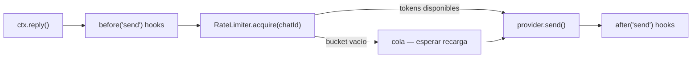

# Rate Limiting (Anti-Ban)

WhatsApp **banea cuentas** que envían demasiados mensajes en poco tiempo. El rate limiter integrado del provider Baileys protege tu bot automáticamente — está **activo por defecto** y se sitúa dentro del pipeline de envío saliente del provider, así que cada `ctx.reply()`, `bot.sendText()`, `bot.broadcast()` y envío de media pasa por él.

::: tip Pacing propio de cada transporte
En v2 la política de pacing vive en el **provider**, no en el core: cada
transporte puede aplicar sus propios límites (429s de Telegram, buckets de
Discord, tiers de la Cloud API — expuestos como `RateLimitedError` tipados).
Esta página cubre el limiter de token bucket de WhatsApp (Baileys) que
configuras al construir `BaileysProvider`.
:::

## Cómo funciona

El limiter usa un algoritmo de **token bucket** con dos buckets independientes:

- **Por chat** — limita qué tan rápido puedes enviar a una *sola* conversación.
- **Global** — limita tu throughput saliente *total* entre todos los chats.

Cuando un bucket se vacía, los mensajes se **encolan** (nunca se descartan) y se liberan conforme los tokens se recargan. Un **jitter** opcional agrega un delay aleatorio tipo humano entre envíos.



## Configuración

Pasa `rateLimit` al constructor del **provider**:

```ts
import { Bot } from '@botmesh/core'
import { BaileysProvider } from '@botmesh/baileys'

const bot = new Bot({
  provider: new BaileysProvider({
    session: 'mi-bot',
    rateLimit: {
      perChat: { max: 5, window: '10s' },   // máx 5 msgs por chat cada 10s
      global:  { max: 50, window: '60s' },   // máx 50 msgs totales cada 60s
      jitter:  { min: 500, max: 1500 },      // delay aleatorio 500–1500ms entre envíos
    },
  }),
})
```

| Opción | Tipo | Default | Descripción |
|---|---|---|---|
| `perChat.max` | `number` | `5` | Máx mensajes por chat en la ventana |
| `perChat.window` | `string \| number` | `'10s'` | Ventana de tiempo (ej. `'10s'`, `'1m'`, `60000`) |
| `global.max` | `number` | `50` | Máx mensajes totales en la ventana |
| `global.window` | `string \| number` | `'60s'` | Ventana de tiempo |
| `jitter.min` | `number` | `0` | Delay mínimo entre envíos (ms) |
| `jitter.max` | `number` | `0` | Delay máximo entre envíos (ms) |
| `enabled` | `boolean` | `true` | Pon `false` para desactivar completamente |

## Desactivar el rate limiting

Para tests o entornos de alta confianza:

```ts
const bot = new Bot({
  provider: new BaileysProvider({
    session: 'mi-bot',
    rateLimit: { enabled: false },
  }),
})
```

## Configuraciones recomendadas

| Escenario | perChat | global | jitter |
|---|---|---|---|
| Soporte al cliente (bajo volumen) | `5 / 10s` | `30 / 60s` | `500–1500ms` |
| Notificaciones / broadcasts | `3 / 10s` | `20 / 60s` | `1000–3000ms` |
| Flujos interactivos (respuestas rápidas) | `10 / 10s` | `100 / 60s` | `200–500ms` |
| Desarrollo / tests | desactivado | desactivado | — |

::: warning Las cuentas nuevas son más sensibles
Un número de WhatsApp recién registrado se banea más rápido que uno con antigüedad. Empieza conservador (`3 / 10s` por chat, `20 / 60s` global) y aumenta gradualmente.
:::

## Acceso programático

La instancia de `RateLimiter` es interna, pero puedes importar la clase desde el paquete de transporte para uso avanzado:

```ts
import { RateLimiter } from '@botmesh/baileys'

const limiter = new RateLimiter({
  perChat: { max: 5, window: '10s' },
  global: { max: 50, window: '60s' },
})

await limiter.acquire('573001234567@s.whatsapp.net') // resuelve cuando se permite
console.log(limiter.pending) // mensajes esperando en cola
limiter.reset() // limpia buckets + rechaza envíos en cola
```

## Interacción con hooks `before('send')`

El rate limiter corre **después** de los hooks `before('send')` pero **antes** del envío real al provider. Si un hook aborta el envío, el rate limiter nunca se consulta — los envíos abortados no consumen tokens.
