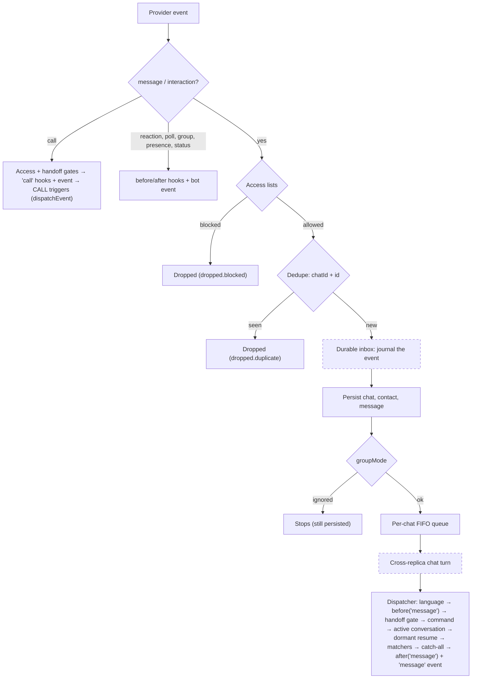
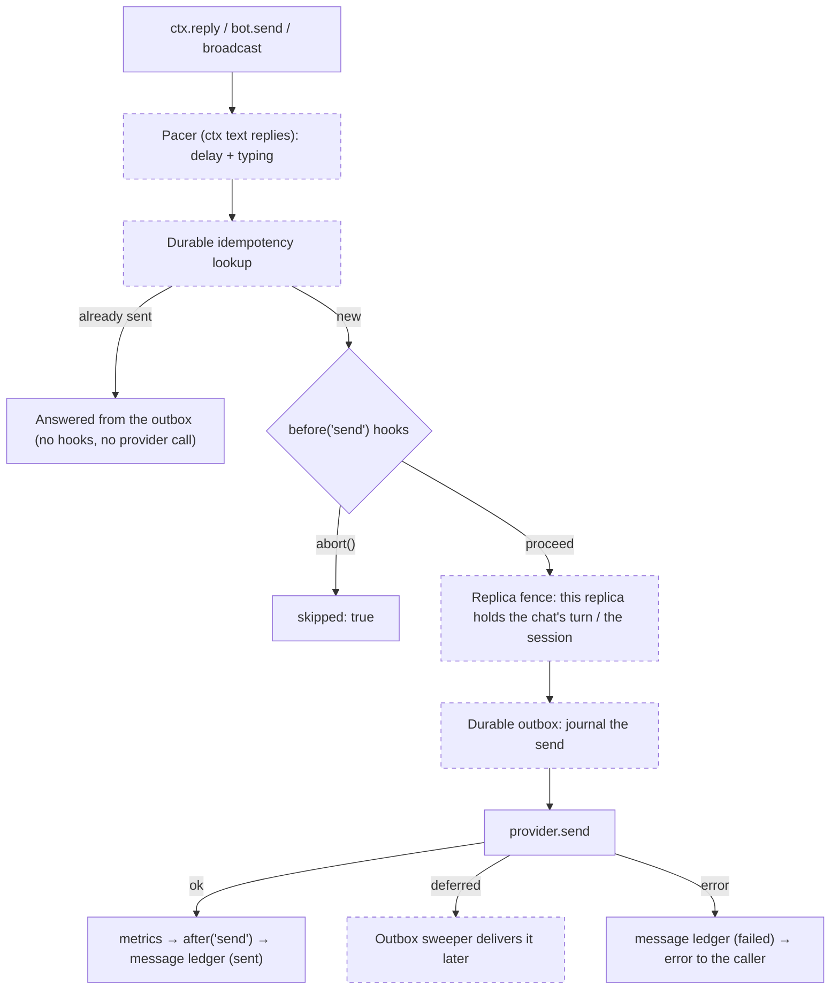
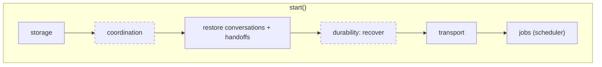

# Architecture

How `@botmesh/core` is put together: the package layers, the modules behind the `Bot`
class, the path a message takes in and out, and where the opt-in features
(durability, multi-replica coordination, the durable scheduler, tracing) plug in.
You don't need any of this to write a bot. It is for people who extend the core,
write a channel or store, or debug what happens between the provider and a handler.

## Layers

The framework is a pnpm monorepo. Dependencies only point **down**:

| Layer | Packages |
| --- | --- |
| Engine | `@botmesh/core` (its only runtime dependency is `pino`) |
| Shared infrastructure | `@botmesh/http` (anti-SSRF client), `@botmesh/graph-core` (Meta Graph helpers) |
| Channels | `@botmesh/baileys`, `@botmesh/meta`, `@botmesh/telegram`, … (each implements `IProvider`) |
| Stores | `@botmesh/sqlite-store`, `@botmesh/redis-store`, … (each implements `IStore`) |
| Plugins / product | `@botmesh/ai`, `nlu`, `manager`, `inbox`, … |

The core is **transport-agnostic**. It knows nothing about JIDs, QR codes or
webhooks: chat, user and message ids are opaque strings it never parses, and the
provider resolves identity aliases (LID/PN on WhatsApp, `sender_chat` on Telegram)
**before** it emits an event, so the same person always arrives with the same
`senderId`. Everything channel-specific lives in the channel package.

## Inside the `Bot`

`Bot` is a thin **facade**: its methods carry the public documentation and delegate.
The engine lives in `packages/core/src/core/bot/`:

| Module | Responsibility |
| --- | --- |
| `compose.ts` | The constructor body: config defaults, logger, store + namespace, every subsystem, in a fixed order; builds the kernel and the modules below |
| `kernel.ts` | `BotKernel`, the shared internals (subsystems + lifecycle state) every module receives, plus tiny shared helpers |
| `lifecycle.ts` | `start()` / `stop()` as an ordered list of steps, with rollback and drain |
| `inbound.ts` | The provider's event stream → access gates → dedupe → persistence → `groupMode` → Dispatcher; calls and provider events (reactions, receipts…) |
| `outbound.ts` | Sends and edits through the `send` hooks, the message ledger, paced replies, typing and `ctx.stream()` |
| `contextFactory.ts` | Builds the `MessageContext` (`ctx`) of a message, a projected call or a `bot.trigger()` |
| `gates.ts` | Access lists and human handoff admission, with their drop counters and logs |
| `lang.ts` | `ctx.lang` resolution and the Dispatcher's language seams |
| `persistence.ts` | Chat / contact / handoff writes, ordered per chat |
| `events.ts` | The error and observability event outlet |
| `routes.ts` | `when`, `conversation`, `command`, `onMessage`, `onType`, hooks |
| `pluginHost.ts` | `plug()`: a scoped bot whose registrations are undone on unplug |
| `ops.ts` | `trigger`, `triggerFlow`, `broadcast`, metrics, flow inventory, subject-data collaborators |

Three rules keep this working:

- **No `#private` fields on `Bot`.** A plugin receives `Object.create(bot)` as
  `ctx.bot`; its methods run with `this` set to that object, and a `#private` read
  through it would throw. The kernel is reached through `this`, so through the
  prototype.
- **Late-bound seams.** Modules call the bot back through closures (`bot.emit`,
  `bot.trigger`, `bot.isHandedOff`…) read at call time, so a spy, a subclass
  override or a plugin-scoped override installed later is honoured.
- **Behaviour goes in a module, not in the facade.** Each module stays under 500
  lines and opens with a comment saying what it does and what it does not.

## Inbound pipeline

Dashed boxes only exist when their feature is configured.

The routing stages inside the Dispatcher, in order, are described in
[Core concepts](/guide/concepts). Two entry points skip parts of this path:
**calls** go through the same access and handoff gates and only reach `CALL` type
triggers, and **`bot.trigger()`** goes through the access lists, then takes the
chat's queue slot (`runExclusive`), the handoff gate and language resolution, and
starts the conversation directly — no dedupe, persistence, message hooks or matchers.

## Outbound pipeline

`ctx.edit()` takes the same path with `edit` on the hook payload. The live previews
of `ctx.stream()` (drafts and in-place edits) run only the `before('send')` hooks;
the messages a stream finally sends take the full path. `bot.enqueue()` (durability
only) runs the `before('send')` hooks, journals the send and returns at once; the
outbox sweeper delivers it.

## Lifecycle

`stop()` closes inbound and cancels broadcasts, stops or pauses the steps that
produce new work (scheduler, durability sweeper), optionally drains in-flight sends
(`stop({ drain: true })`), closes paced sends and aborts conversations (checkpoints
are kept), then stops the remaining steps in reverse order. If `start()` fails, the
steps already started are rolled back in reverse order and the error is rethrown.

An opt-in feature adds a **lifecycle step**; it does not scatter `if`s through the
start and stop code.

## Where the opt-ins plug in

All of them are off by default. A bot that does not configure them runs exactly the
code path described above without the dashed boxes.

| Feature | Config | Stages it touches | Guide |
| --- | --- | --- | --- |
| Durable processing | `durability` | Inbound: journals each event in an **inbox** before dispatch and acknowledges it once the work it started settled; replays it after a crash. Outbound: idempotency lookup and an **outbox** journal per send, with retries and a dead-letter queue. Lifecycle: a `durability` step | [Durable processing](/guide/durability) |
| Multi-replica coordination | `coordination` | Inbound: each chat is processed under a cross-replica **turn**, in ingress order. Outbound: a **fence** refuses sends from a replica that lost its turn or the provider session. Lifecycle: a `coordination` step and leader election for exclusive transports. With `coordination.handover`, flow checkpoints carry the cut-short answer and non-persistent flows can be forwarded | [Running N replicas](/guide/replicas) |
| Durable scheduler | `scheduler` | Jobs: tasks with an `id` are stored, survive restarts with a missed-run policy and run on one replica per occurrence (a **lease**) | [Scheduler](/guide/scheduler) |
| Tracing | `telemetry` | Wraps the stages it observes in spans without changing their order or timing: provider event (`bot.inbound`), persistence, dispatch, handler, each conversation turn between waits, pacing and every send; `@botmesh/ai` adds model and tool spans. `@botmesh/otel` (outside the core, `@opentelemetry/api` as an optional peer) exports them. Each scheduled task run is a root `bot.task` span, and a conversation resumed on another replica (or after a restart) links its first turn to the turn that wrote the checkpoint (`FlowCheckpoint.trace`, W3C) | [Tracing](/guide/tracing) |

## See also

- [Core concepts](/guide/concepts): the full routing order and conversations.
- [Hooks](/guide/hooks): the `message` and `send` hook contracts.
- [Plugins](/guide/plugins): what a plugin-scoped bot tracks and undoes.
