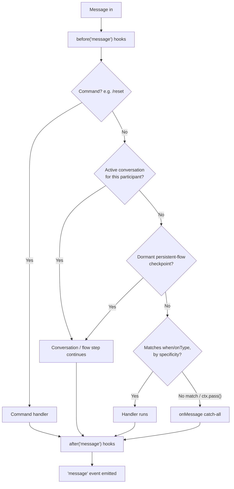

# Core Concepts

Understand how the **Dispatcher** decides what happens to each incoming
message, and the pieces you compose a bot from.

## The Dispatcher pipeline

Every incoming message goes through the same pipeline, in this order. The
first thing that **consumes** the message wins and stops the pipeline:



1. **Commands** (`/reset`, `/help`, ...) always win — even over an active
   conversation. That's what lets `/reset` escape a stuck flow.
2. **Active conversation** — if this participant already started a `flow`
   or `bot.conversation` that's waiting for a reply, the message goes there.
3. **Dormant resume** — if a `.persistent()` flow was checkpointed in the
   store (e.g. before a restart), the flow resumes at the saved step.
4. **Matchers** registered with `bot.when(...)`, tried by specificity
   (an exact string/`equals` match beats a broad regex or a media-type
   handler like `onImage`).
5. **`bot.onMessage()`** — the catch-all, runs **only** if nothing above
   consumed the message.

Handlers **consume by default**: once one runs, the pipeline stops there.
Call `ctx.pass()` inside a handler to yield to the next matching handler
instead of stopping — this is how low-specificity handlers like `onImage`/
`onType` cooperate with a broader `when`:

```ts
bot.when(/.+/, async (ctx) => {
  if (ctx.type === 'image') { ctx.pass(); return } // yield to the next handler
  await ctx.reply('text received')
})

bot.onImage(async (ctx) => {
  await ctx.reply('image received') // now reached, because the handler above passed
})
```

### 1. Bot + Provider — the center

```ts
import { Bot } from '@bot-wa/core'
import { BaileysProvider } from '@bot-wa/baileys'

const bot = new Bot({ provider: new BaileysProvider({ session: 'my-bot' }) })
await bot.start()
```

The `Bot` (from `@bot-wa/core`) is the transport-agnostic engine: it runs
the Dispatcher, hooks, flows, conversations and the scheduler. The
**provider** is the transport boundary — `@bot-wa/baileys` connects to
WhatsApp; `@bot-wa/meta` (official Cloud API), `@bot-wa/telegram` and the
experimental Messenger, Instagram and Discord transports plug into the same
engine. All transports feed the bot
the same normalized events.

### 2. when — simple responses

```ts
bot.when('hola', async (ctx) => {
  await ctx.reply('👋 Hello!')
})
```

**When** the message matches the trigger, run this function. The default
match strategy is **normalized equals**: lowercased, accents stripped,
spaces collapsed — `'hola'` matches "hola"/"Hóla ", but NOT "/hola" or
"hola amigo". Triggers accept text, a list, a regex, a predicate, or an
explicit `{ pattern, match, scope }` object:

```ts
bot.when('hola', handler)
bot.when(['bye', 'goodbye'], handler)
bot.when(/\d{4,}/, handler)
bot.when({ pattern: 'factura', match: 'contains' }, handler) // v1-style "contains"
```

### 3. flow / conversation — multi-step conversations

```ts
const register = flow('registrar')
  .ask('Name?', 'name')
  .say((_ctx, c) => `Hi ${c.state.name}`)

bot.use(register)
```

A **flow** compiles to a real async conversation: the bot asks, the user
answers, `c.state` stores it and the flow continues — with validation,
retries, branching (`choose`) and timeouts. For full manual control you can
skip the DSL and write `bot.conversation(name, async (c, ctx) => {...})`
directly.

### 4. Hooks — middleware (before / after / onError)

```ts
bot.before('message', async (ctx, next) => {
  console.log('📥', ctx.from, ctx.body)
  await next()
})

bot.after('message', async (ctx) => {
  console.log('📤 processed')
})

bot.onError('message', async (ctx, error) => {
  console.error('💥 error:', error)
})
```

Hooks run **before** or **after** each message, like Express middleware.
`'message'` is the main hook event; `'send'` fires on every outbound send.

### 5. Plugins — packaged functionality

```ts
bot.plug(slashCommandsPlugin, { greeting: 'Hi!' })
```

A plugin is a reusable package that can register hooks, handlers and tools.
`bot.plug()` returns an `unplug()` function that reverts everything it
registered.

## `'message'` event vs `onMessage()`

These look similar but are not the same:

- `bot.on('message', ctx => ...)` fires for **every** message the
  Dispatcher finished processing — including ones a command, an active
  conversation, or a `when` handler already consumed.
- `bot.onMessage(ctx => ...)` is the **catch-all** — it only runs when
  nothing else consumed the message.

## Group conversations are per-participant by default

In a group, two different participants talking to the bot in the same chat
get **independent conversations** by default (keyed internally by
`${from}:${sender}`). Use `conversationScope: 'chat'` if you want a single
shared conversation per group chat instead:

```ts
const bot = new Bot({
  provider: new BaileysProvider({ session: 'my-bot' }),
  conversationScope: 'chat',
})
```

## The ctx object — your best friend

```ts
bot.when('hola', async (ctx) => {
  console.log(ctx.body)        // message text
  console.log(ctx.from)        // chat id (opaque; a JID on WhatsApp/Baileys)
  console.log(ctx.sender)      // sender id (= from in DMs, participant in groups)
  console.log(ctx.type)        // 'text', 'image', 'audio', ...
  console.log(ctx.isGroup)     // is it a group?

  await ctx.reply('text')
  await ctx.photo(url, 'caption')
  await ctx.poll('Question?', ['A', 'B'])
  await ctx.react('👍')

  const db = ctx.tools.db  // injected tool
})
```

## Chat and sender ids

`ctx.from` (chat) and `ctx.sender` (user) are **opaque strings** the
provider resolves — the core never sniffs their shape. For the Baileys
transport they happen to be WhatsApp **JIDs** (Jabber IDs):

| Type | Format | Example |
|---|---|---|
| User | `number@s.whatsapp.net` | `573001234567@s.whatsapp.net` |
| Group | `id@g.us` | `120363xxx@g.us` |
| Newsletter | `id@newsletter` | `120363xxx@newsletter` |

You don't need to memorize this — `ctx.from` gives you the correct id on
every transport. If you need the transport-native key of the inbound
message (to quote/edit/delete it with provider calls), use `ctx.ref`
(`{ id, chatId, native? }`).

## Next steps

- [Messages & media](./messages) — all reply types
- [Conversation flows](./flows) — complex conversations
- [Hooks](./hooks) — middleware and logging
- [Examples](/examples/messages) — practical recipes
