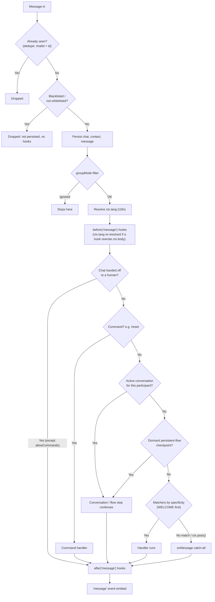

# Core Concepts

Understand how the **Dispatcher** decides what happens to each incoming
message, and the pieces you compose a bot from.

## The inbound pipeline

Every incoming message goes through the same pipeline, in this order. The
first four steps run in the `Bot` as soon as the provider emits the event;
the rest run inside the Dispatcher, on a **FIFO queue per chat** (two
messages from the same chat are never processed in parallel). The first
thing that **consumes** the message wins and stops the routing:



1. **Inbound dedupe**: a redelivered message or interaction (same `chatId`
   + id, from webhook retries or a Baileys offline resync) is dropped before
   anything else. On by default; see [Inbound dedupe](#inbound-dedupe).
2. **Blacklist / whitelist**: a blocked sender or chat is dropped silently.
   It is not persisted, no hooks run and no `'message'` event fires. See
   [Handoff & access lists](./handoff#blacklist-and-whitelist).
3. **Persistence**: the chat, contact and message are upserted in the store.
4. **`groupMode` filter**: a group message the bot must ignore stops here
   (it is still persisted).
5. **Language resolution, then `before('message')` hooks**: when
   [i18n](./i18n) is enabled, `ctx.lang` is resolved first (stored
   `ctx.user` preference → provider-reported language → `detect` →
   default), so hooks and handlers already see it (`ctx.langSource` says
   which one won). Then the hooks run and may `abort()` the message. If a
   hook rewrote `ctx.body` (e.g. the `@bot-wa/voice` transcript) and
   the language came from `detect` or the default, it is resolved again so
   `detect` sees the final text (a `ctx.lang` a hook set itself is kept).
6. **Handoff gate**: while a chat is [handed off to a human](./handoff),
   steps 7–11 are skipped (except the commands in `handoff.allowCommands`).
   The message is still persisted, hooks still run and `'message'` still
   fires.
7. **Commands** (`/reset`, `/help`, ...) always win, even over an active
   conversation. That's what lets `/reset` escape a stuck flow.
8. **Active conversation**: if this participant already started a `flow`
   or `bot.conversation` that's waiting for a reply, the message goes there.
9. **Dormant resume**: if a `.persistent()` flow was checkpointed in the
   store (e.g. before a restart), the flow resumes at the saved step.
10. **Matchers** registered with `bot.when(...)`, tried by specificity:
    [`WELCOME`](./triggers#welcome) (first contact only), then text triggers
    (an exact string/`equals` match beats `startsWith`, a regex or
    `contains`), then predicate functions, then single-type triggers
    (`IMAGE`, `onImage`...), then multi-type triggers (`MEDIA`). With equal
    specificity, the one registered first wins.
11. **`bot.onMessage()`**: the catch-all (also `aiPlugin`). It runs **only**
    if nothing above consumed the message.
12. **Finish**: `after('message')` hooks, then the `'message'` event
    (`bot.onIdle` timers re-arm here).

Incoming **calls** take a separate path: the access-list and handoff gates
come **first** and block a call completely (no `'call'` hooks, no `'call'`
event, no `CALL` trigger; it counts in `metrics().dropped`). An admitted call
runs the `before`/`after('call')` hooks and the `'call'` event, then the same
language resolution and only [`CALL` triggers](./triggers#call). No message
hooks, commands or `'message'` event.

`bot.trigger(name, { chatId })` (start a flow without an inbound message;
`bot.triggerFlow()` is a thin wrapper over it with `ifActive: 'replace'`)
takes its own path too: the access lists, then the chat's FIFO slot, the
handoff gate, the language resolution and the conversation start. No dedupe,
persistence, message hooks, matchers or `'message'` event.

If a handler throws, the `onError('message')` hooks run and the error is
always emitted on `bot.on('error', ({ error, ctx }) => ...)`, even when no
error hook is registered.

Handlers **consume by default**: once one runs, the pipeline stops there.
Call `ctx.pass()` inside a handler to yield to the next matching handler
instead of stopping — this is how low-specificity handlers like `onImage`/
`onType` cooperate with a broader `when`:

```ts
bot.when(/.+/, async (ctx) => {
  if (ctx.type === 'image') { ctx.pass(); return } // yield to the next handler
  await ctx.reply('text received')
})

bot.onImage(async (ctx) => {
  await ctx.reply('image received') // now reached, because the handler above passed
})
```

### 1. Bot + Provider — the center

```ts
import { Bot } from '@bot-wa/core'
import { BaileysProvider } from '@bot-wa/baileys'

const bot = new Bot({ provider: new BaileysProvider({ session: 'my-bot' }) })
await bot.start()
```

The `Bot` (from `@bot-wa/core`) is the transport-agnostic engine: it runs
the Dispatcher, hooks, flows, conversations and the scheduler. The
**provider** is the transport boundary — `@bot-wa/baileys` connects to
WhatsApp; `@bot-wa/meta` (official Cloud API), `@bot-wa/telegram` and the
experimental Messenger, Instagram and Discord transports plug into the same
engine. All transports feed the bot
the same normalized events.

### 2. when — simple responses

```ts
bot.when('hola', async (ctx) => {
  await ctx.reply('👋 Hello!')
})
```

**When** the message matches the trigger, run this function. The default
match strategy is **normalized equals**: lowercased, accents stripped,
spaces collapsed — `'hola'` matches "hola"/"Hóla ", but NOT "/hola" or
"hola amigo". Triggers accept text, a list, a regex, a predicate, or an
explicit `{ pattern, match, scope }` object:

```ts
bot.when('hola', handler)
bot.when(['bye', 'goodbye'], handler)
bot.when(/\d{4,}/, handler)
bot.when({ pattern: 'factura', match: 'contains' }, handler) // v1-style "contains"
```

### 3. flow / conversation — multi-step conversations

```ts
const register = flow('registrar')
  .ask('Name?', 'name')
  .say((_ctx, c) => `Hi ${c.state.name}`)

bot.use(register)
```

A **flow** compiles to a real async conversation: the bot asks, the user
answers, `c.state` stores it and the flow continues — with validation,
retries, branching (`choose`) and timeouts. For full manual control you can
skip the DSL and write `bot.conversation(name, async (c, ctx) => {...})`
directly.

### 4. Hooks — middleware (before / after / onError)

```ts
bot.before('message', async (ctx, next) => {
  console.log('📥', ctx.from, ctx.body)
  await next()
})

bot.after('message', async (ctx) => {
  console.log('📤 processed')
})

bot.onError('message', async (ctx, error) => {
  console.error('💥 error:', error)
})
```

Hooks run **before** or **after** each message, like Express middleware.
`'message'` is the main hook event; `'send'` fires on every outbound send.
A `before` hook that returns without calling `next()` stops the event, like
`ctx.abort()`.

### 5. Plugins — packaged functionality

```ts
bot.plug(slashCommandsPlugin, { greeting: 'Hi!' })
```

A plugin is a reusable package that can register hooks, handlers and tools.
`bot.plug()` returns an `unplug()` function that reverts everything it
registered.

## Inbound dedupe

Webhook transports (Cloud API, Messenger, Instagram, Telegram webhook) retry
a delivery when they don't get a 2xx in time, and Baileys can redeliver
recent messages after a reconnect. Without protection, the same message
would start a flow twice, or be consumed as the answer to the *next*
question of a conversation. The `Bot` drops redeliveries before they reach
any handler. It is **on by default**:

```ts
new Bot({ provider })                                     // default: { size: 1000 }, no TTL
new Bot({ provider, dedupe: { size: 5000, ttl: '1h' } })  // tune it
new Bot({ provider, dedupe: false })                      // turn it off
```

- A message is keyed by `chatId` + `ref.id`, because some transports only
  make ids unique per chat (e.g. Telegram `message_id`). An interaction
  (button or list tap) is keyed by its `interactionId`, so two taps on the
  same menu are two events.
- Edits: the same id with a **different** body (Telegram `edited_message`) is
  processed; an identical retry is dropped. Only a hash of the body is kept,
  never the text.
- Events with an empty id are never deduplicated.
- If persistence fails before the handlers run (store down), the key is
  released so the transport's retry is processed.
- `size` is an LRU; `ttl` (ms or `'30s'`/`'10m'`/`'1h'`) counts from the
  first acceptance.
- **Limit:** it lives in process memory. It does not deduplicate across
  replicas or after a restart.

Providers must give each inbound event an id that names exactly one logical
event, stays the same when it is redelivered, and is `''` when the
transport cannot guarantee that. This is the **inbound id contract**,
documented on `IProvider`. Advanced: `InboundDeduper`,
`createInboundDeduper`, `inboundDedupeKey` and `DEFAULT_DEDUPE_SIZE` are
exported from `@bot-wa/core`.

## `'message'` event vs `onMessage()`

These look similar but are not the same:

- `bot.on('message', ctx => ...)` fires for **every** message the
  Dispatcher finished processing — including ones a command, an active
  conversation, or a `when` handler already consumed.
- `bot.onMessage(ctx => ...)` is the **catch-all** — it only runs when
  nothing else consumed the message.

## Group conversations are per-participant by default

In a group, two different participants talking to the bot in the same chat
get **independent conversations** by default (keyed internally by
`${from}:${sender}`). Use `conversationScope: 'chat'` if you want a single
shared conversation per group chat instead:

```ts
const bot = new Bot({
  provider: new BaileysProvider({ session: 'my-bot' }),
  conversationScope: 'chat',
})
```

## The ctx object — your best friend

```ts
bot.when('hola', async (ctx) => {
  console.log(ctx.body)        // message text
  console.log(ctx.from)        // chat id (opaque; a JID on WhatsApp/Baileys)
  console.log(ctx.sender)      // sender id (= from in DMs, participant in groups)
  console.log(ctx.type)        // 'text', 'image', 'audio', ...
  console.log(ctx.isGroup)     // is it a group?

  await ctx.reply('text')
  await ctx.photo(url, 'caption')
  await ctx.poll('Question?', ['A', 'B'])
  await ctx.react('👍')

  const db = ctx.tools.db  // injected tool
  await ctx.user.set('lang', 'en')   // persistent per-user profile
})
```

## Chat and sender ids

`ctx.from` (chat) and `ctx.sender` (user) are **opaque strings** the
provider resolves — the core never sniffs their shape. For the Baileys
transport they happen to be WhatsApp **JIDs** (Jabber IDs):

| Type | Format | Example |
|---|---|---|
| User | `number@s.whatsapp.net` | `573001234567@s.whatsapp.net` |
| Group | `id@g.us` | `120363xxx@g.us` |
| Newsletter | `id@newsletter` | `120363xxx@newsletter` |

You don't need to memorize this — `ctx.from` gives you the correct id on
every transport. If you need the transport-native key of the inbound
message (to quote/edit/delete it with provider calls), use `ctx.ref`
(`{ id, chatId, native? }`).

## Next steps

- [Messages & media](./messages) — all reply types
- [Conversation flows](./flows) — complex conversations
- [Hooks](./hooks) — middleware and logging
- [Special triggers](./triggers) — WELCOME, message types and CALL
- [Handoff & access lists](./handoff) — pause the bot for a human, block senders
- [Examples](/examples/messages) — practical recipes
