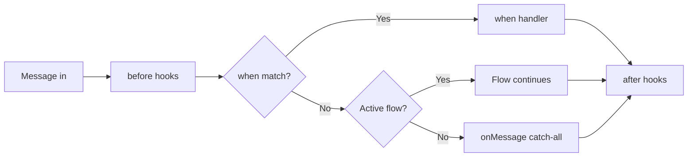

# Core Concepts

Understand the 5 pieces that make up bot-wa-baileys.

## The 5 pieces



### 1. Bot — the center

```js
const bot = new Bot({ session: 'my-bot' })
await bot.start()
```

The `Bot` is the main instance. It connects to WhatsApp, routes messages,
runs hooks and manages flows.

### 2. when — simple responses

```js
bot.when('hi', async (ctx) => {
  await ctx.reply('👋 Hello!')
})
```

**When** someone sends a message containing "hi", run this function.
Accepts text, regex or lists:

```js
bot.when('hi', handler)
bot.when(['bye', 'goodbye'], handler)
bot.when(/\d{4,}/, handler)
```

### 3. flow — multi-step conversations

```js
const register = flow('register')
  .say('Name?', { capture: true })
  .do(async (ctx, { state }) => state.set('name', ctx.body))
  .say(async (ctx, { state }) => `Hi ${state.get('name')}`)
  .end()

bot.use(register)
```

A **flow** is a conversation with steps. The bot asks, the user answers,
the bot stores and continues. Has capture, validation, branching, timeout, fallback.

### 4. Hooks — middleware (before / after / onError)

```js
bot.before('message', async (ctx, next) => {
  console.log('📥', ctx.from, ctx.body)
  await next()
})

bot.after('message', async (ctx) => {
  console.log('📤 processed')
})

bot.onError('message', async (ctx, error) => {
  console.error('💥 error:', error)
})
```

Hooks run **before** or **after** each message. Like Express middleware.

### 5. Plugins — packaged functionality

```js
bot.plug(slashCommandsPlugin, { greeting: 'Hi!' })
```

A plugin is a reusable package that can register hooks, handlers, tools, etc.

## The ctx object — your best friend

```js
bot.when('hi', async (ctx) => {
  console.log(ctx.body)        // message text
  console.log(ctx.from)        // sender JID
  console.log(ctx.type)        // 'text', 'image', 'audio', ...
  console.log(ctx.isGroup)     // is it a group?
  console.log(ctx.sender)      // { id, pushName }

  await ctx.reply('text')
  await ctx.photo(url, 'caption')
  await ctx.voice(url)
  await ctx.sticker(url, { pack, author })
  await ctx.location(lat, lng, name)
  await ctx.contact(phone, name)
  await ctx.poll(question, options)
  await ctx.react('👍')

  const db = ctx.tools.db  // injected tool
})
```

## What is a JID?

A **JID** (Jabber ID) is a WhatsApp chat identifier:

| Type | Format | Example |
|---|---|---|
| User | `number@s.whatsapp.net` | `573001234567@s.whatsapp.net` |
| Group | `id@g.us` | `120363xxx@g.us` |
| Newsletter | `id@newsletter` | `120363xxx@newsletter` |

You don't need to memorize this — `ctx.from` gives you the correct JID.

## Next steps

- [Messages & media](./messages) — all reply types
- [Conversation flows](./flows) — complex conversations
- [Hooks](./hooks) — middleware and logging
- [Examples](/examples/messages) — practical recipes