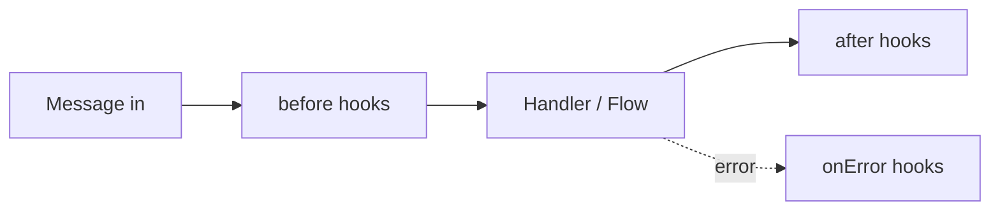

# Hooks (Middleware)

Hooks are functions that run **before** or **after** each message. Like
Express middleware: intercept, modify, decide whether to continue.

## The 3 types



### before — before processing

```js
bot.before('message', async (ctx, next) => {
  console.log('📥', ctx.from, ':', ctx.body)
  await next()  // ← important: call next() to continue
})
```

::: warning Don't forget next()
If you don't call `next()`, the message **is not processed**. Useful for
blocking messages (rate limiting, filters, etc.).
:::

### after — after processing

```js
bot.after('message', async (ctx) => {
  console.log('📤 processed:', ctx.type)
})
```

### onError — when something fails

```js
bot.onError('message', async (ctx, error) => {
  console.error('💥 error:', error)
  if (ctx) await ctx.reply('😅 An error occurred. Try again.')
})
```

## Use cases

### Logging

```js
bot.before('message', async (ctx, next) => {
  console.log(`📥 [${new Date().toISOString()}] ${ctx.from}: ${ctx.body}`)
  await next()
})
```

### Rate limiting

```js
const counts = new Map()

bot.before('message', async (ctx, next) => {
  const now = Date.now()
  let entry = counts.get(ctx.from)

  if (!entry || entry.resetAt < now) {
    entry = { count: 0, resetAt: now + 60000 }
    counts.set(ctx.from, entry)
  }

  entry.count++
  if (entry.count > 10) {
    await ctx.reply('⏳ Too many messages. Wait a minute.')
    ctx.abort()
    return
  }

  await next()
})
```

### Filter groups

```js
bot.before('message', async (ctx, next) => {
  if (ctx.isGroup) return
  await next()
})
```

### Block users

```js
const blocked = new Set(['57300XXXXXXX@s.whatsapp.net'])

bot.before('message', async (ctx, next) => {
  if (blocked.has(ctx.from)) {
    ctx.abort()
    return
  }
  await next()
})
```

## abort() — stop the pipeline

```js
bot.before('message', async (ctx, next) => {
  if (someCondition) {
    ctx.abort()
    return
  }
  await next()
})
```

## Priority

```js
bot.before('message', handler, 10)  // higher = runs first
bot.before('message', handler, 0)   // default
```

## Available events

| Event | When |
|---|---|
| `message` | Incoming message |
| `send` | Outgoing message |
| `connection` | Connection change |
| `group` | Group event (join, leave, promote) |
| `call` | Incoming call |
| `presence` | Presence change |
| `reaction` | Message reaction |
| `poll` | Poll vote |

## Next steps

- [Plugins](./plugins) — package hooks for reuse
- [Example: rate limiter](/examples/rate-limiter) — full plugin