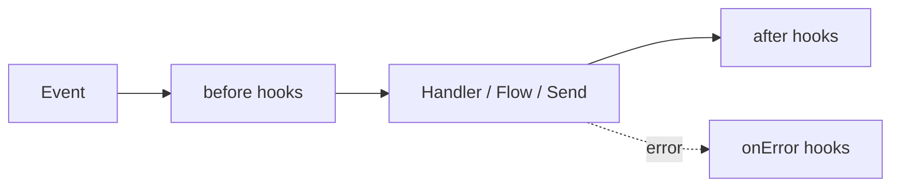

# Hooks (Middleware)

Hooks are functions that run **before** or **after** an event. Like Express
middleware: intercept, modify, decide whether to continue.

## The 3 types



### before — before processing

```ts
bot.before('message', async (ctx, next) => {
  console.log('📥', ctx.from, ':', ctx.body)
  await next()  // ← important: call next() to continue
})
```

::: warning Forgetting next() blocks the event
A `before` hook that returns **without calling `next()`** stops the chain
and the event, exactly like `ctx.abort()`: the message is not routed (a
`'send'` is skipped, a provider event is not emitted). A hook that only
observes or rewrites must always end with `await next()`. To block on
purpose (rate limiting, filters) either return without `next()` or call
`ctx.abort()` (see `abort()` below) — `abort()` reads more explicitly.
:::

### after — after processing

```ts
bot.after('message', async (ctx) => {
  console.log('📤 processed:', ctx.type)
})
```

### onError — when something fails

```ts
bot.onError('message', async (ctx, error) => {
  console.error('💥 error:', error)
  if (ctx) await ctx.reply('😅 An error occurred. Try again.')
})
```

There's also a generic `bot.hook(event, phase, handler, priority?)` if you
need to register a phase dynamically instead of calling `before`/`after`/
`onError` directly.

A handler error is **always** emitted on `bot.on('error', ({ error, ctx }) => ...)`,
whether or not an `onError('message')` hook is registered.

## Use cases

### Logging

```ts
bot.before('message', async (ctx, next) => {
  console.log(`📥 [${new Date().toISOString()}] ${ctx.from}: ${ctx.body}`)
  await next()
})
```

### Rate limiting

```ts
const counts = new Map()

bot.before('message', async (ctx, next) => {
  const now = Date.now()
  let entry = counts.get(ctx.from)

  if (!entry || entry.resetAt < now) {
    entry = { count: 0, resetAt: now + 60000 }
    counts.set(ctx.from, entry)
  }

  entry.count++
  if (entry.count > 10) {
    await ctx.reply('⏳ Too many messages. Wait a minute.')
    ctx.abort()
    return
  }

  await next()
})
```

### Filter groups

```ts
bot.before('message', async (ctx, next) => {
  if (ctx.isGroup) return  // no next(): the message stops here (same as ctx.abort())
  await next()
})
```

For group messages the built-in [`groupMode`](./concepts#the-inbound-pipeline) option is usually
simpler: it filters before the hooks even run.

### Block users

```ts
const blocked = new Set(['57300XXXXXXX@s.whatsapp.net'])

bot.before('message', async (ctx, next) => {
  if (blocked.has(ctx.from)) {
    ctx.abort()
    return
  }
  await next()
})
```

For a real block list prefer the built-in `bot.blacklist` / `bot.whitelist`:
they drop the message before it is even persisted and also cover button
taps and calls. See [Handoff & access lists](./handoff#blacklist-and-whitelist).

## Transform or block outgoing messages

`'send'` fires on **every** outbound send, whether it comes from
`ctx.reply`/`ctx.photo`/... or from `bot.send`/`bot.sendText`. The payload
is `{ chatId, content, options }` — `content` is the transport-neutral
`OutboundContent` (`{ kind: 'text', text }`, `{ kind: 'image', media,
caption }`, ...); mutate it to transform a message, or abort to skip the
send entirely:

```ts
bot.before('send', async (payload, next) => {
  console.log('📤 sending to', payload.chatId, payload.content)
  await next()
})
```

An aborted send resolves `{ skipped: true }` instead of rejecting (a
[broadcast](./messages#broadcasts) counts it as `skipped`).

### Edits and streamed output

Some payloads carry a marker so a hook can tell them apart from a plain send:

| Marker | Sent by | Hooks that run |
| --- | --- | --- |
| `edit: ref` | [`ctx.edit()`](./messages#edit-a-message) editing a message in place | `before` + `after` |
| `stream: 'message'` | a new message [`ctx.stream()`](./streaming) sends (the first message of an edit stream, a sentence chunk, the final message after drafts) | `before` + `after` |
| `stream: 'edit'` | a live update of a streamed message | `before` only |
| `stream: 'draft'` | a native draft preview (Telegram) | `before` only |

A hook can rewrite `payload.content` or `abort()` any of them. An aborted edit
resolves `skipped` and sends no new message in its place. A degraded edit (the
provider cannot edit) goes out as a normal send, without `edit`.

```ts
let sentCount = 0
bot.before('send', async (payload, next) => {
  // Redact card numbers everywhere, live previews included
  if (payload.content.kind === 'text') {
    payload.content.text = payload.content.text.replace(/\b\d{13,16}\b/g, '[card]')
  }
  // Count new messages only: live previews repeat the same text many times
  if (payload.stream !== 'draft' && payload.stream !== 'edit' && !payload.edit) sentCount++
  await next()
})
```

## abort() — stop the pipeline

`abort()` stops the remaining `before` hooks and the event itself. Returning
without `next()` has the same effect; `abort()` also works from code that has
no `next` at hand (a helper that receives only `ctx`).

```ts
bot.before('message', async (ctx, next) => {
  if (someCondition) {
    ctx.abort()
    return
  }
  await next()
})
```

## Priority

```ts
bot.before('message', handler, 10)  // higher = runs first
bot.before('message', handler, 0)   // default
```

## Available events

| Event | When |
|---|---|
| `message` | The main pipeline — an incoming message being processed |
| `send` | Any outbound message, from a `ctx` reply helper or `bot.send*` (also edits and streamed output, see above) |
| `reaction`, `poll`, `group`, `presence`, `status` | Provider events (a reaction, a poll vote, a group update, presence, a delivery/read receipt): `before` and `after` hooks run, then the matching `bot.on(...)` event. A `before` hook that aborts (or skips `next()`) suppresses the `after` hooks and the event |
| `call` | An incoming call. `before('call', (ev) => ev.abort())` keeps it away from [`CALL` triggers](./triggers#call), the `after('call')` hooks and the `'call'` event |

Provider-level connection events (`qr`, `ready`, `connection`, ...) are
plain `bot.on(...)` listeners, not hook phases — see [Core concepts](./concepts).
The same goes for `'conversation:started'` / `'conversation:ended'`
(see [Operations](./operations#conversation-events)).

## Next steps

- [Plugins](./plugins) — package hooks for reuse
- [Example: rate limiter](/examples/rate-limiter) — full plugin
