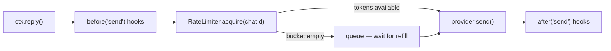

# Rate Limiting (Anti-Ban)

WhatsApp **bans accounts** that send too many messages in a short period. The Baileys provider's built-in rate limiter protects your bot automatically — it's **enabled by default** and sits inside the provider's outbound send pipeline, so every `ctx.reply()`, `bot.sendText()`, `bot.broadcast()` and media send passes through it.

::: tip Transport-owned pacing
In v2 the pacing policy lives on the **transport provider**, not on the
core: each transport may enforce its own limits (Telegram 429s, Discord
buckets, Cloud API tiers — surfaced as typed `RateLimitedError`s). This
page covers the WhatsApp (Baileys) token-bucket limiter you configure when
constructing `BaileysProvider`.
:::

## How it works

The limiter uses a **token bucket** algorithm with two independent buckets:

- **Per-chat** — limits how fast you can send to a *single* conversation.
- **Global** — limits your *total* outbound throughput across all chats.

When a bucket is empty, messages are **queued** (never dropped) and released as tokens refill. An optional **jitter** adds a random human-like delay between sends.



## Configuration

Pass `rateLimit` to the **provider** constructor:

```ts
import { Bot } from '@bot-wa/core'
import { BaileysProvider } from '@bot-wa/baileys'

const bot = new Bot({
  provider: new BaileysProvider({
    session: 'my-bot',
    rateLimit: {
      perChat: { max: 5, window: '10s' },   // max 5 msgs per chat per 10s
      global:  { max: 50, window: '60s' },   // max 50 msgs total per 60s
      jitter:  { min: 500, max: 1500 },      // random 500–1500ms between sends
    },
  }),
})
```

| Option | Type | Default | Description |
|---|---|---|---|
| `perChat.max` | `number` | `5` | Max messages per chat in the window |
| `perChat.window` | `string \| number` | `'10s'` | Time window (e.g. `'10s'`, `'1m'`, `60000`) |
| `global.max` | `number` | `50` | Max total messages in the window |
| `global.window` | `string \| number` | `'60s'` | Time window |
| `jitter.min` | `number` | `0` | Minimum delay between sends (ms) |
| `jitter.max` | `number` | `0` | Maximum delay between sends (ms) |
| `enabled` | `boolean` | `true` | Set `false` to disable entirely |

## Disable rate limiting

For tests or high-throughput trusted environments:

```ts
const bot = new Bot({
  provider: new BaileysProvider({
    session: 'my-bot',
    rateLimit: { enabled: false },
  }),
})
```

## Recommended settings

| Scenario | perChat | global | jitter |
|---|---|---|---|
| Customer support (low volume) | `5 / 10s` | `30 / 60s` | `500–1500ms` |
| Notifications / broadcasts | `3 / 10s` | `20 / 60s` | `1000–3000ms` |
| Interactive flows (fast replies) | `10 / 10s` | `100 / 60s` | `200–500ms` |
| Development / tests | disabled | disabled | — |

::: warning New accounts are more sensitive
A freshly registered WhatsApp number gets banned faster than an aged one. Start conservative (`3 / 10s` per chat, `20 / 60s` global) and increase gradually.
:::

## Programmatic access

The `RateLimiter` instance is internal, but you can import the class from the transport package for advanced use:

```ts
import { RateLimiter } from '@bot-wa/baileys'

const limiter = new RateLimiter({
  perChat: { max: 5, window: '10s' },
  global: { max: 50, window: '60s' },
})

await limiter.acquire('573001234567@s.whatsapp.net') // resolves when allowed
console.log(limiter.pending) // messages waiting in queue
limiter.reset() // clear buckets + reject queued sends
```

## How it interacts with `before('send')` hooks

The rate limiter runs **after** `before('send')` hooks but **before** the actual provider send. If a hook aborts the send, the rate limiter is never consulted — aborted sends don't consume tokens.
