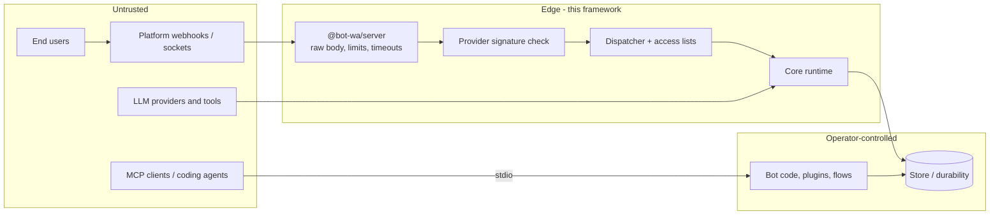

# Threat model

What this framework protects, from whom, and what it explicitly does **not** protect. The
safety gate in [`ROADMAP.md`](https://github.com/andresayac/bot-wa-baileys/blob/main/ROADMAP.md)
requires this document and its [release checklist](https://github.com/andresayac/bot-wa-baileys/blob/main/CONTRIBUTING.md#checklist-de-release)
to stay current; the per-surface findings, the fixes made and the residual risks live in
[Security](security.md).

## Assets

| Asset | Why it matters | Where it lives |
| --- | --- | --- |
| Session credentials | A WhatsApp/Telegram/IMAP session is the account: leaking it hands over the identity | `sessions/`, `*_sessions/`, provider config, `baileys_store.json` |
| Bot secrets | Provider tokens, API keys, webhook secrets, app secrets | Environment/`.env`, provider config, `BotConfig` |
| Message content and media | Personal data of the end users (bodies, captions, attachments, locations) | Store, checkpoints, journal, logs, traces |
| Operational data | Multi-tenant configs, campaign recipients, inbox notes, gate runs | `manager`, `deployments`, `inbox`, `crm`, `campaigns`, `hub` |
| Tenant boundaries | One customer must never read or drive another customer's bot | Namespaces, store keys, REST `/v1`, `tenant-kv` |
| Bot availability | A hung or flooded bot is a business outage and, on WhatsApp, a ban risk | Ingress, dispatcher queues, rate limiter |

## Trust boundaries

Trusted: the operator's bot code, plugins and flows, and the machine the process runs on.
Untrusted: every platform payload, every end-user message, every model answer, every byte
fetched from a URL that came from a payload, and any MCP client that talks to
`@bot-wa/mcp`.

## Threats and controls

| # | Threat | Surface | Control | Residual risk |
| --- | --- | --- | --- | --- |
| T1 | Forged webhook (fake message or call) | 13 channels | Platform signature over the **raw** body, constant-time comparison, provider refuses to start without credentials | Replay where the platform signs no timestamp (see below) |
| T2 | Payload flood / oversized body | Webhook ingress | `@bot-wa/server` limits body size, per-body and ingest timeouts, concurrency cap, `413`/`408`/`503` | The operator still sizes the process and the reverse proxy |
| T3 | SSRF from a user-supplied URL (media, TTS, embeddings) | Every outbound fetch | `secureFetch`: HTTPS, private ranges rejected, socket pinned to the checked IP, redirects re-validated, size/time caps | DNS answers can change after the check only if a provider bypasses `secureFetch` |
| T4 | Path traversal through ids (tenant, bot, chat, flow) | REST `/v1`, manager, MCP docs | Ids restricted to `[A-Za-z0-9][A-Za-z0-9_.:-]{0,63}`, filenames derived from them, docs paths resolved and rejected outside the root | None known |
| T5 | Code execution from a stored flow | JSON flow documents | Data-only schema: no code, no module import, no `eval`; safe expression grammar (no regex, no prototype access, bounded length/depth); `http` step goes through `secureFetch` | An `http` step can still call a public endpoint the operator allowed |
| T6 | Cross-tenant read/write | Store, manager, product packages | Namespace per bot, tenant-scoped keys in `tenant-kv`, compare-and-set, REST scopes and `404` for other tenants | A custom `IStore` implementation can break its own isolation |
| T7 | Secret or personal data in logs/traces | Logger, OpenTelemetry | No bodies, prompts, QR payloads or tokens in framework logs; spans carry ids through the `ids` policy (`hash` by default) and never message content | Operator code that logs `ctx.body` |
| T8 | Prompt injection driving tools | `@bot-wa/ai` | Tools are opt-in per call, destructive ones need `confirm: true`, the model cannot invent tool ids (`tools: ['id']` filters the configured set) | A read-only tool can still leak whatever the operator gave it |
| T9 | Untrusted code inside the process | Plugins | `Plugin.install` is synchronous, plugins only get the scoped facade, no sandbox | **Plugins run in-process with full Node permissions: install only code you trust** |
| T10 | Ban of the WhatsApp number | Baileys / gateways | Opt-in rate limiter, typing/pacing, no button spam, `exclusiveSession` for single-connection transports | Automating WhatsApp Web is unofficial and always carries ban risk |
| T11 | Agent reads or writes something it should not | `@bot-wa/mcp` | Local stdio only (no network listener), read-only tools, no `eval`, docs reads confined to the configured root, no writes to disk | The client decides what to do with the answers |
| T12 | Replay of a captured webhook | Meta, Telegram, Twilio, HighLevel, Gupshup, WPPConnect | Platform id dedupe in memory + store-backed dedupe window | No platform timestamp to enforce a window; keep endpoints on HTTPS |

## Assumptions

- HTTPS terminates at the operator's reverse proxy or platform; the process itself speaks
  plain HTTP on the loopback interface.
- The machine is not shared with untrusted users: plugins and bot code are trusted.
- Secrets arrive from the environment; the framework never reads `.env` on its own.
- The operator's store is authenticated and not reachable from the internet.

## Out of scope

- Multi-tenant authentication beyond the manager's tokens (no OIDC, no RBAC).
- Hardening of the operator's host, container, database or reverse proxy.
- WhatsApp / Meta / Telegram / Twilio terms of service compliance, and the legal basis
  for processing end-user data.
- Denial of service above the ingress limits (network layer).
- Model quality, hallucinations or vendor data-retention policies.

## Reporting

Open a private advisory through
[`SECURITY.md`](https://github.com/andresayac/bot-wa-baileys/blob/main/SECURITY.md); never a
public issue. A fix lands with a regression test named `security-audit` in its package.
